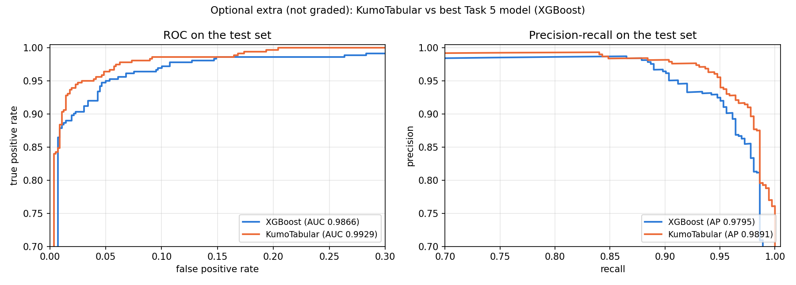

# External platform comparison: KumoTabular vs our best model (optional, not graded)

This folder is **not part of the graded work**. The project rules allow only scikit-learn, XGBoost, pandas, NumPy and
Matplotlib, and an external tool may be used only if the instructor allows it. So this comparison is kept out of
`notebook.ipynb` and `report/report.pdf`, and nothing there depends on it.

## What was run

KumoTabular (Kumo's open `structured-data-models` package) is a *pretrained tabular foundation model*. It does not fit
weights on our data: the labelled training rows are passed in as context and the test rows are predicted in one forward
pass (in-context learning). We ran it ourselves, locally on CPU. No Kumo API or hosted service was called.

| step | script | needs |
|---|---|---|
| 1. export our exact split (3,680 labelled training e-mails, 921 unlabelled test e-mails) | `export_for_kumo.py` | requirements.txt |
| 2. run KumoTabular (defaults: `num_estimators = 8`, threshold 0.5) -> `data/kumo/kumo_predictions.csv` | `kumo_predict.py` | `requirements-kumo.txt` (PyTorch 2.15.0, structured-data-models 0.2.1; 812 MB model download) |
| 3. score it against the best Task 5 model (XGBoost) | `compare.py` | requirements.txt |

```bash
python extras/kumo/export_for_kumo.py
pip install -r extras/kumo/requirements-kumo.txt
python extras/kumo/kumo_predict.py
python extras/kumo/compare.py
```

`compare.py` re-fits XGBoost with the CV-selected setting from Task 5 and asserts that its test accuracy equals the
notebook's (0.9468), and it uses the same bootstrap resamples as notebook section X1. Results go to `results/`.

## Differences from our protocol

* **Same split.** Same stratified split (`random_state = 42`). The test labels were never passed to the model.
* **Rule 3 is not fully met.** Training and test *features* were encoded together in one table, as in the package's
  example, so any per-column normalisation inside the package saw the test features (never their labels).
* **No training-set threshold.** Our cost thresholds are chosen on out-of-fold training predictions. That would need
  Kumo run inside 5-fold CV, which we did not do, so Kumo's cost at 0.95 uses XGBoost's threshold.
* **Unknown pretraining data.** Spambase is public, and we cannot check whether similar data were in Kumo's pretraining set.

## Results

| model | accuracy [95% CI] | precision | recall | F1 [95% CI] | ROC AUC | AP |
|---|---|---|---|---|---|---|
| XGBoost (Task 5) | 0.9468 [0.932, 0.961] | 0.9337 | 0.9311 | 0.9324 [0.913, 0.951] | 0.9866 | 0.9795 |
| KumoTabular | **0.9609** [0.948, 0.973] | 0.9504 | 0.9504 | **0.9504** [0.934, 0.965] | **0.9929** | **0.9891** |

Table A — test metrics with 95% paired-bootstrap CIs, 2,000 resamples (`results/kumo_vs_xgboost_metrics.csv`).

| comparison | accuracy difference [95% CI] | Kumo right / XGB wrong | Kumo wrong / XGB right | both wrong | McNemar p (exact) |
|---|---|---|---|---|---|
| KumoTabular − XGBoost | +0.014 [+0.003, +0.025] | 20 | 7 | 29 | 0.019 |

Table B — paired comparison on the same 921 test e-mails (`results/kumo_paired_test.csv`).

| model | threshold | FP | FN | cost per 1,000 e-mails | accuracy |
|---|---|---|---|---|---|
| XGBoost | 0.5 | 24 | 25 | 288 | 0.947 |
| XGBoost | 0.95 (chosen on training OOF) | 4 | 58 | 106 | 0.933 |
| KumoTabular | 0.5 | 18 | 18 | 215 | 0.961 |
| KumoTabular | 0.95 (borrowed, not tuned for Kumo) | 2 | 70 | 98 | 0.922 |

Table C — cost view, FP = 10, FN = 1 (`results/kumo_cost.csv`).



Figure A — ROC and precision-recall curves on the test set (`results/kumo_roc_pr.png`).

## Interpretation

* **Kumo is better on this test set, without any tuning.** It gains 1.4 points of accuracy and 1.8 points of F1, and its
  ROC curve is above XGBoost's mainly at false-positive rates of 1–10%, the region a spam filter uses.
* **The gain is unlikely to be chance.** The bootstrap interval of the difference excludes 0, and on the 27 e-mails where
  the models disagree Kumo is right 20 times (p = 0.019, one planned test). The 29 e-mails both get wrong show that the
  two models share most of their hard cases.
* **The cost comparison is only indicative.** At 0.5 Kumo costs 215 vs 288 per 1,000 e-mails. At the borrowed 0.95
  threshold it reaches 98 vs 106, but that threshold was not chosen for Kumo by our rules.
* **Why XGBoost stays our best model.** The comparison is not fully fair (shared feature encoding, unknown pretraining
  data, a single test set), and Kumo cannot be cross-validated, tuned or explained inside our protocol. It also needed
  PyTorch, an 812 MB model download and 167 s of CPU inference, against well under a second for XGBoost.
* **Engineering lesson.** Pretrained tabular models are now competitive with a carefully tuned boosted model on small,
  clean tables at almost no effort. The price is control and transparency. A fair verdict would run Kumo inside the same
  nested-CV protocol, which we leave as future work.

## Problem we hit

The first run crashed after inference: the model returns its own `TableTensor` object, not a PyTorch tensor, so
`.detach()` failed. We read the package source, took the class-`"1"` probability column by name and added a check that
the scores are probabilities. The second run worked (167 s on CPU).
