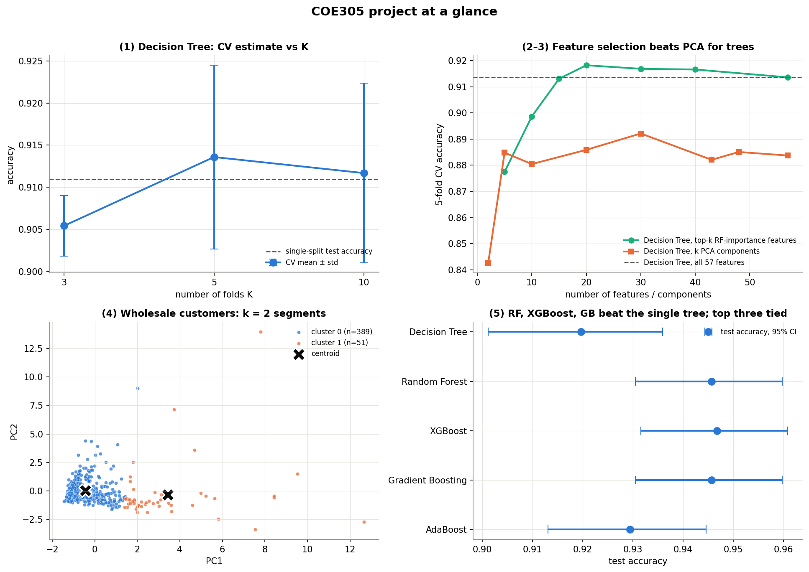
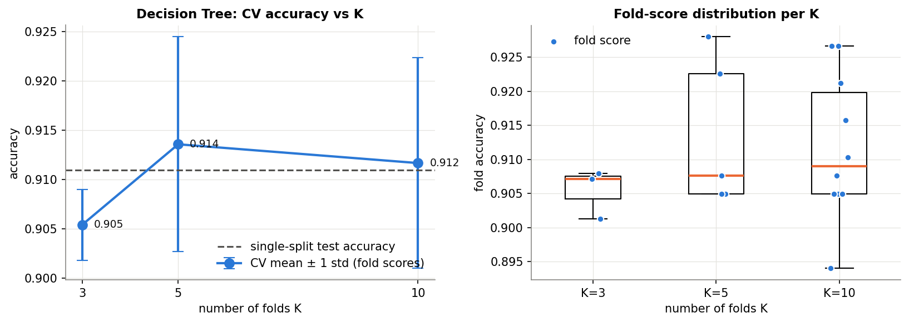
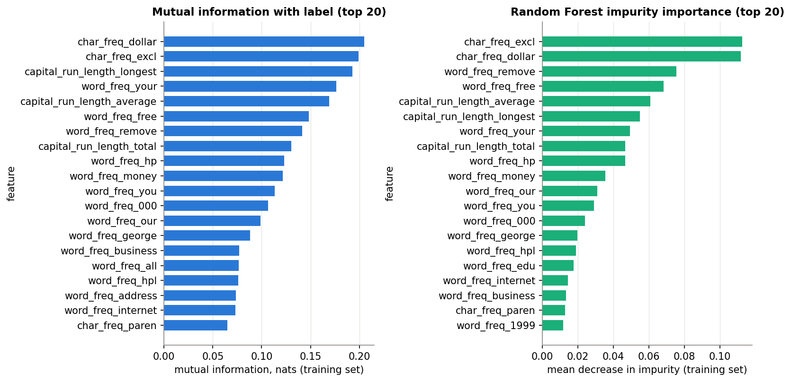
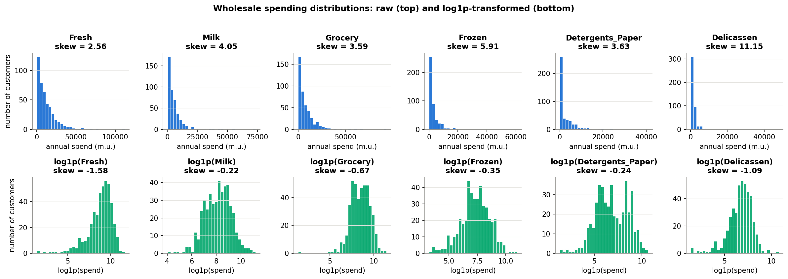
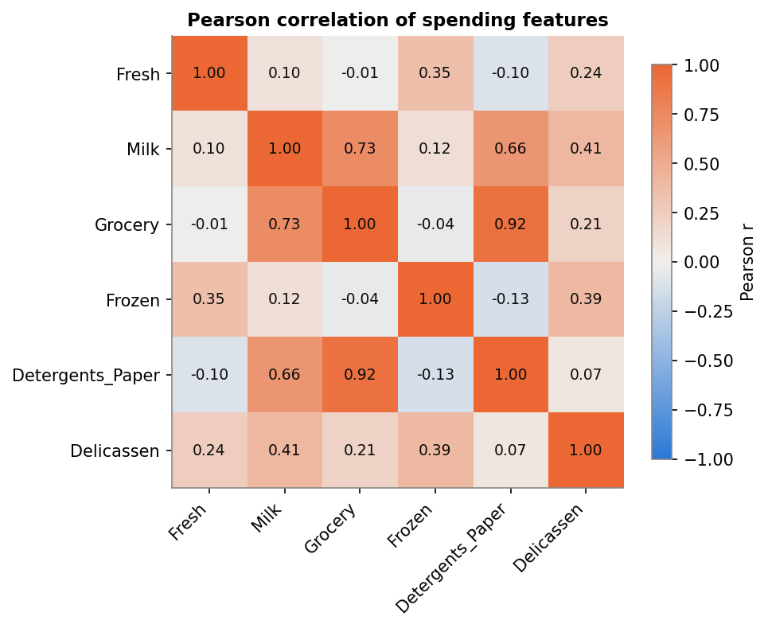
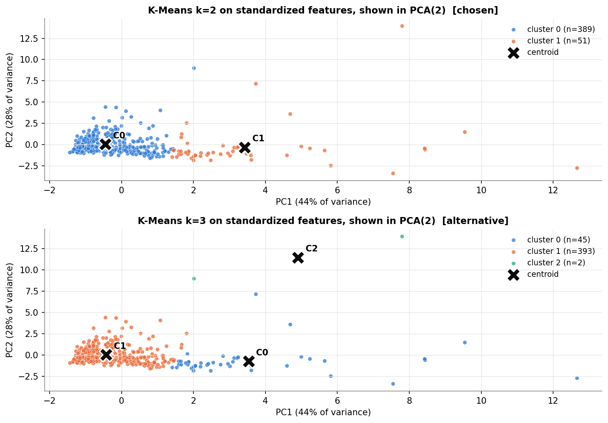
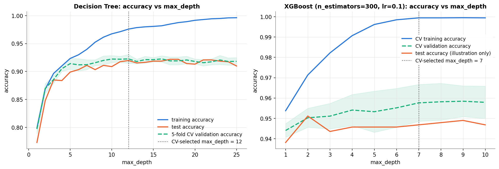
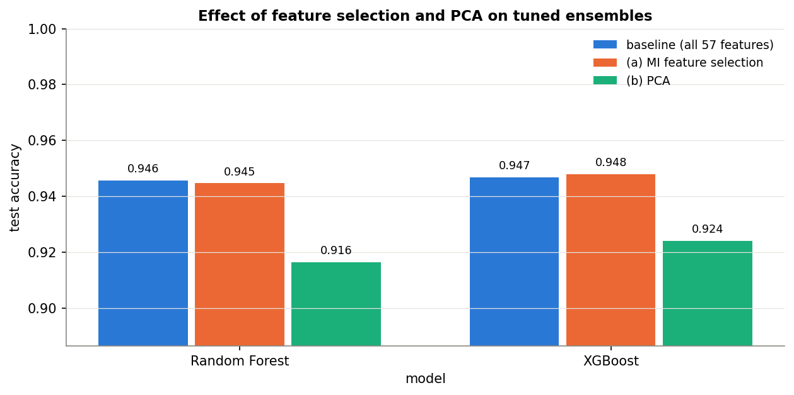
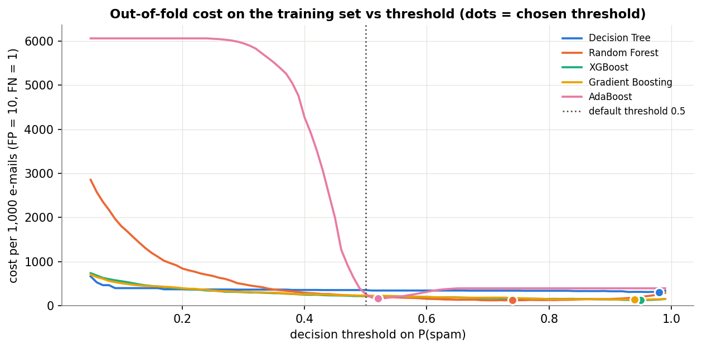
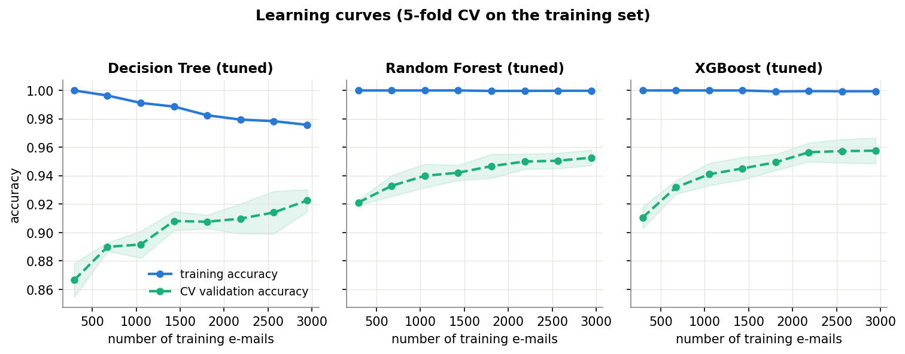

# COE305 Machine Learning — Practical Project Report

**Fall 2026–2027**

| Student | Student ID |
|---|---|
| Mohammed Bendardf | 229912053 |
| Abdalraouf Alkabir | 2309015482 |

Submission deadline: 20 November 2026, 17:00 (Istanbul, UTC+3)

Deliverables: `notebook.ipynb` (executed), `report/report.pdf`, `figures/`, `tables/`

# Executive summary

{: style="width:100%"}

Figure 0 — The project at a glance (figures/x5_overview.png; panels re-plot results of Tasks 1–5 and Appendix A.1). Panel 5 shows test accuracy with 95% paired-bootstrap confidence intervals (CIs); RF = Random Forest, GB = Gradient Boosting. Its title rests on McNemar's tests with Holm correction (tables/x1_mcnemar.csv): Random Forest, XGBoost and Gradient Boosting each beat the single tree significantly (Holm p 0.012–0.021), AdaBoost's lead over it is not significant (Holm p 1.0), and the three do not differ significantly from each other (Holm p 1.0).

* **Cross-validation (Task 1).** 3-fold CV under-estimates a decision tree's accuracy (0.905). 5- and 10-fold CV agree (0.914 / 0.912) with the single-split test score (0.911). Repeating the CV shows that its mean becomes *more stable* as K grows (std 0.0045 → 0.0021).
* **Feature selection vs PCA (Tasks 2–3).** About 20 of 57 features chosen by Random-Forest importance give the same or better accuracy (test 0.923 vs 0.911). PCA needs 43 components for 90% variance and never improves accuracy. It costs trees at least 2 points, because variance is not the same as class information.
* **Clustering (Task 4).** Wholesale customers split into a large fresh-oriented Horeca/small-shop group (88%) and a high-volume retail-basket group (12%; 90% *Retail* in a post-hoc check). The split is sensitive to extreme spenders, but k=2 and the same split survive when they are capped.
* **Ensembles (Task 5).** **XGBoost** is the best model by CV accuracy (0.958), with test accuracy **0.947 [95% CI 0.932–0.961]** and F1 0.932. Random Forest and Gradient Boosting are not significantly different from it (McNemar p = 1.0), and all three clearly beat a single tree.
* **Beyond the requirements (Appendix A).** Nested CV is consistent with a small optimism (up to 0.5 points) in the tuned CV scores. A cost-aware decision threshold (false alarm = 10 missed spams) cuts the error cost by 63%. Permutation importance reveals that the model relies heavily on the mailbox owner's personal words (*george*, *hp*, *edu*), which is a hidden generalisation risk.

# 1. Introduction

This project studies five core machine-learning techniques on two public UCI datasets:

1. cross-validation (Task 1);
2. feature selection (Task 2);
3. feature extraction with PCA (Task 3);
4. K-Means clustering (Task 4);
5. decision trees and tree ensembles (Task 5).

Tasks 1, 2, 3 and 5 are supervised binary classification on **Spambase**. Task 4 is unsupervised segmentation of the **Wholesale Customers** data. All work uses Python with scikit-learn 1.5.2, XGBoost 2.1.3, pandas, NumPy and Matplotlib. No AutoML or hosted service was used. Every number in this report comes from `notebook.ipynb` (its printed outputs or the CSVs in `tables/`). Every figure is saved in `figures/`.

# 2. Data

**Spambase (UCI #94).** 4,601 e-mails, 57 numeric features (48 word frequencies, 6 character frequencies, 3 statistics on runs of capital letters) and the label `spam` (1 = spam, 39.4%). There are no missing values. The data contain 391 exact duplicate rows (all 57 features and the label equal; every copy after the first is counted), which were not removed: 104 of the 921 test e-mails have an exact copy (all 57 features and the label equal) among the 3,680 training e-mails, so absolute test scores may be slightly optimistic, while model comparisons hold because all models share the same split. The notebook prints both counts right after the train/test split. Six feature names contain symbols (`char_freq_[`, `char_freq_$`, …). XGBoost rejects the `[` in `char_freq_[`, so all six symbol names were renamed (e.g. `char_freq_dollar`, `char_freq_excl`) by the notebook's loader `load_spambase` (see Section 9).

**Wholesale Customers (UCI #292).** 440 customers of a Portuguese wholesale distributor with annual spending (monetary units, m.u.) on six categories: Fresh, Milk, Grocery, Frozen, Detergents_Paper and Delicassen. `Channel` and `Region` were dropped before clustering. `Channel` is used once, *after* clustering, as a post-hoc check.

Both datasets are committed in `data/`. If a file is missing, the notebook downloads it from the UCI repository (OpenML as a fallback), checks it against the SHA-256 hash of the committed CSV and saves it to `data/`.

# 3. Methodology

**One split.** `get_split` (notebook setup cell) creates one stratified train/test split (`test_size=0.2`, `random_state=42`): 3,680 training and 921 test e-mails, with the spam rate preserved (39.4% in both; Table 1). The same split is used in Tasks 1, 2, 3 and 5.

| set | rows | spam rate |
|---|---|---|
| full | 4,601 | 0.3940 |
| train | 3,680 | 0.3940 |
| test | 921 | 0.3941 |

Table 1 — The single stratified split (tables/t0_split_summary.csv).

**Selection only on training data.** Every choice — K-fold settings, number of selected features k, number of PCA components, hyper-parameters, pruning strength α — is made with stratified K-fold CV on the training set (`StratifiedKFold(5, shuffle=True, random_state=42)` unless stated otherwise). The test set is used once per final model.

**No leakage.** `StandardScaler`, `SelectKBest`, `RFE`, `SelectFromModel` and `PCA` are always steps of an `sklearn.pipeline.Pipeline`. Inside `GridSearchCV`/`cross_val_score` they are therefore refit on every training fold, and for the final model they are fitted on the training set only, then applied to the test set. A grep of the notebook confirms that every `.fit(` / `fit_transform(` call on Spambase uses `X_train` (Section 10, Verification). Task 4 has no train/test split (unsupervised), so fitting the scaler and PCA on all 440 rows is legitimate.

**Seeds and metrics.** `random_state=42` everywhere and `np.random.seed(42)`. Classification metrics: accuracy, plus precision, recall and F1 for the spam class, because the classes are mildly imbalanced (the majority-class baseline is 60.6%). Figures are 150-dpi PNGs.

# 4. Task 1 — Cross-Validation

**Baseline.** A default `DecisionTreeClassifier` grows to depth 32 with 237 leaves. It scores 0.9997 on the training set but 0.9110 on the test set (Table 2). The 9-point gap shows strong over-fitting, so training accuracy is useless as an estimate.

| set | accuracy | precision | recall | F1 |
|---|---|---|---|---|
| train | 0.9997 | 1.0000 | 0.9993 | 0.9997 |
| test | 0.9110 | 0.8828 | 0.8926 | 0.8877 |

Table 2 — Decision Tree baseline (tables/t1_baseline.csv).

| K | mean acc | std acc | mean F1 | std F1 | time (s) | train rows/fold | std of CV mean (10 repeats) |
|---|---|---|---|---|---|---|---|
| 3 | 0.9054 | 0.0036 | 0.8804 | 0.0051 | 0.21 | 2,453 | 0.0045 |
| 5 | 0.9136 | 0.0109 | 0.8910 | 0.0134 | 0.37 | 2,944 | 0.0034 |
| 10 | 0.9117 | 0.0107 | 0.8884 | 0.0136 | 0.70 | 3,312 | 0.0021 |

Table 3 — Stratified K-fold CV on the training set (tables/t1_cv_comparison.csv; per-fold values in tables/t1_fold_scores.csv).

{: style="width:100%"}

Figure 1 — Left: CV mean ± 1 std vs K, with the single-split test accuracy as a dashed line. Right: distribution of fold scores (figures/t1_cv_accuracy_vs_k.png).

**Interpretation (Table 3, Figure 1).**

* **Bias.** K=3 gives the most pessimistic estimate (0.905). Each model sees only 67% of the training data, so the estimate is biased downwards. K=5 and K=10 agree (0.914 / 0.912).
* **Stability.** The std across folds is *larger* for K=5/10 (≈0.011) than for K=3 (0.004), because smaller validation folds give noisier individual scores. The quantity that matters for model selection is the variability of the CV *mean*. We measured it by repeating each CV with 10 different shuffles: it *decreases* with K (0.0045 → 0.0034 → 0.0021). So larger K gives a less biased and more stable estimate.
* **Runtime** grows with K (0.21 → 0.37 → 0.70 s): K fits, each on a larger part of the training set. Wall-clock times depend on the machine and its load (up to about 4× between runs on the same laptop) and are not results; only the ordering is stable.
* **CV vs single split.** The single-split accuracy (0.9110) lies inside the K=5 and K=10 intervals (mean ± 1 std), just above the K=3 interval (0.9018–0.9090), and matches K=10. It is one draw with a standard error of about 0.009, and it gives no spread. CV reuses all training data and also provides the uncertainty.
* We use K=5 for all later model selection as the compromise between bias, stability and cost.

# 5. Task 2 — Feature Selection

**Method.** We applied three selectors, all followed by the Task 1 Decision Tree (its baseline is reused):

* **Filter:** mutual information `SelectKBest`.
* **Wrapper:** `RFE` with a decision tree.
* **Embedded:** top-k Random-Forest importances via `SelectFromModel`.

Each selector is the first pipeline step, and k ∈ {5, 10, 15, 20, 30, 40, 57} is chosen by 5-fold CV.

{: style="width:100%"}

Figure 2 — Mutual information and RF importance, top 20 features, both computed on the training set (figures/t2_feature_scores.png, tables/t2_feature_scores.csv).

**Interpretation (Figure 2).** The two rankings share all of their top-10 features: `char_freq_$`, `char_freq_!`, the three capital-run-length statistics, and *your, free, remove, hp, money*. Scores fall steeply. Beyond the 20th feature, MI is ≤ 0.059 and RF importance ≤ 1.1%. Word features are sparse (counted over all 4,601 e-mails and printed by the notebook right after the train/test split): 19 of the 48 are zero in at least 90% of the e-mails, the median zero share of the 48 is 86%, and *3d*, *table* and *parts* are zero in 99%, 99% and 98% of them.

**Selected features** (tables/t2_selected_features.csv; each selector fitted on the full training set; "capital runs" = the three capital-run-length statistics; words in italics):

* **MI, SelectKBest (k=20):** capital runs, `!`, `$`, `(`, *address, all, our, remove, internet, free, business, you, your, 000, money, hp, hpl, george*.
* **RFE, Decision Tree (k=40):** capital runs, `!`, `$`, `(`, `;`, `#`, *make, all, 3d, our, over, remove, internet, mail, receive, will, report, free, business, email, you, credit, your, font, money, hp, hpl, george, 650, lab, data, technology, 1999, direct, meeting, original, re, edu*.
* **SelectFromModel, RF importance (k=20):** capital runs, `!`, `$`, `(`, *our, remove, internet, free, business, you, your, 000, money, hp, hpl, george, 1999, edu*.
* **At the common k=15:** all three keep capital runs, `!`, `$` and *our, remove, free, you, your, money, hp, george*; MI adds *business, 000*, RFE *business, edu* and RF importance *000, hpl*.

**Overlap** (tables/t2_overlap_cv_k.csv, tables/t2_overlap_k15.csv):

* **At the CV-selected k** (the features the final models use), MI (20) and RF importance (20) share 18 features (Jaccard 0.82). RFE (40) contains 18 of MI's and 19 of RF's. **17 features are used by all three:** the capital-run trio, `!`, `$`, `(` and *free, remove, money, business, internet, our, you, your, hp, hpl, george*. RFE's other 23 features are mostly weak, mostly-zero words and symbols (*3d, font, meeting*, `;`, `#`, …).
* **At a common k=15** each pair shares 13–14 features (Jaccard 0.76–0.88).

These are the classical spam markers plus strong ham markers: the corpus comes from HP Labs (*hp, hpl*), and *george* is the donor's first name.

Figure 3 — 5-fold CV accuracy vs k, with the all-feature baseline from Task 1 (figures/t2_accuracy_vs_k.png, tables/t2_cv_accuracy_vs_k.csv).

| method | CV-selected k | CV acc | test acc | precision | recall | F1 |
|---|---|---|---|---|---|---|
| all features (Task 1, reused) | 57 | 0.9136 | 0.9110 | 0.8828 | 0.8926 | 0.8877 |
| MI (SelectKBest) | 20 | 0.9171 | 0.9099 | 0.8933 | 0.8760 | 0.8846 |
| RFE (Decision Tree) | 40 | 0.9177 | 0.9164 | 0.8907 | 0.8981 | 0.8944 |
| SelectFromModel (RF importance) | 20 | 0.9182 | **0.9229** | 0.9056 | 0.8981 | 0.9018 |

Table 4 — Test results at the CV-selected k (tables/t2_test_results.csv).

**Interpretation (Figure 3, Table 4).**

* **k ≤ 10: worse than the baseline (under-fitting).** For example, MI with 5 features scores 0.858. MI is weakest here because it ranks features one at a time and so includes overlapping capital-run statistics instead of complementary words.
* **k = 15–40: about the same as or slightly better than the baseline** (CV 0.9114–0.9182 vs 0.9136). The 20–40 weakest features are almost always zero, and a fully grown tree uses them only to split tiny groups, which adds variance. Removing them is mild regularisation. The gain is small because a tree already selects features implicitly.
* **k = 57** reproduces the baseline exactly.
* **Test set.** The RF-importance selector (20 features) gives the best tree (0.9229, F1 0.9018, +1.2 points). RFE gives +0.5 points and MI −0.1 points. The CV gains are within one fold-std, so the robust conclusion is that the same accuracy is reached with about 35% of the features. The model-based selectors win because their rankings are multivariate and, for RF, averaged over 200 trees.

# 6. Task 3 — Feature Extraction with PCA

{: style="width:100%"}

Figure 4 — Explained variance per component and cumulative, with 90% and 95% thresholds; StandardScaler + PCA fitted on the training set only (figures/t3_explained_variance.png, tables/t3_cumulative_variance.csv).

**Interpretation (Figure 4).** Variance is spread very evenly:

* PC1 explains 11.8%, 2 PCs 17.6%, 10 PCs 38.7% and 30 PCs 73.9%;
* **43 components are needed for 90% and 48 for 95%** (of 57).

The features are weakly correlated, so PCA cannot compress them much. The first components capture the few correlated groups:

* PC1: the HP-internal vocabulary *857, 415, telnet, labs, 650, technology*;
* PC2: spam words (*your, 000, $, order*);
* PC3: the capital-run statistics.

**Comparison.** The same classifier, **logistic regression** (L2, C=1), is used in all three set-ups. It is linear like PCA and needs standardised inputs:

* (a) StandardScaler → LR;
* (b) StandardScaler → PCA(n) → LR, with n chosen by CV;
* (c) SelectKBest(MI, k) → StandardScaler → PCA(n) → LR, with k ∈ {20, 30, 40} and every n of the (b) grid with n ≤ k, chosen by CV.

As an extra, the Task 1 Decision Tree is also run on (a) and (b).

| set-up | classifier | dims to classifier | CV acc | test acc | precision | recall | F1 |
|---|---|---|---|---|---|---|---|
| (a) original features | LogReg | 57 | 0.9228 | **0.9294** | 0.9209 | 0.8981 | 0.9093 |
| (b) PCA, CV-chosen n | LogReg | 57 | 0.9231 | **0.9294** | 0.9209 | 0.8981 | 0.9093 |
| (b') PCA, 95%-variance rule | LogReg | 48 | 0.9220 | 0.9273 | 0.9205 | 0.8926 | 0.9063 |
| (c) MI (k=40) → PCA | LogReg | 30 | 0.9114 | 0.9164 | 0.9157 | 0.8678 | 0.8911 |
| extra (a) original | Decision Tree | 57 | 0.9136 | 0.9110 | 0.8828 | 0.8926 | 0.8877 |
| extra (b) PCA | Decision Tree | 30 | 0.8921 | 0.8817 | 0.8508 | 0.8485 | 0.8497 |

Table 5 — Original vs PCA vs selection→PCA (tables/t3_setup_comparison.csv; grid for (c) in tables/t3_fs_pca_grid.csv).

Figure 5 — CV accuracy vs number of components (cumulative variance in brackets) for LR and, as an extra, the Decision Tree (figures/t3_accuracy_vs_components.png, tables/t3_cv_accuracy_vs_components.csv).

**Interpretation (Table 5, Figure 5).**

* **(b) chose no reduction.** CV selected all 57 components. With all components, PCA is just a rotation, and L2 logistic regression is rotation-invariant, so (a) and (b) give *identical* predictions.
* **Real reductions cost accuracy.** With 48 components (95% variance) the test accuracy is 0.9273. With 20 components it falls to about 0.906 CV, and with 2 components to 0.871.
* **(c) loses information twice** (first selection, then compression) and gives 0.9164, even though it may use the same component counts as (b). Its best settings are the ones that compress least.
* **PCA hurts the tree badly** (0.9110 → 0.8817). The tree's best PCA size (30 components, 74% variance) beats larger sizes with more variance. Trees rely on axis-aligned, sparse "word present?" splits, and PCA destroys them by mixing all words into every component.

| component block | variance share | CV accuracy (LR) |
|---|---|---|
| PC1–10 | 38.7% | 0.902 |
| PC11–20 | 19.0% | 0.619 |
| PC21–30 | 16.2% | 0.610 |
| PC31–57 | 26.1% | 0.629 |

Table 6 — LR trained on disjoint blocks of components (tables/t3_variance_vs_accuracy_blocks.csv).

**Does high variance guarantee better classification? No (Table 6).**

* The leading block carries most of the signal here. Yet the lowest-variance block PC31–57 has *more* total variance than PC11–20 and slightly better accuracy, partly because it is larger (27 components vs 10 in each other block), and all later blocks alone are near the 0.606 majority baseline.
* The last 14 components (only 9% of the variance) still raise LR accuracy from 0.917 to 0.923.
* For the tree, accuracy peaks at 30 components (74% variance); every larger size, with more variance, scores *lower*.

PCA is unsupervised: it ranks directions by spread, not by class separation. On Spambase it reduced 57 → 43–48 dimensions at a cost of 0.1–0.6 points (LR) or about 3 points (tree), and never improved accuracy. Supervised feature selection (Task 2) is the better reduction for this data.

# 7. Task 4 — K-Means Clustering (Wholesale Customers)

| feature | mean | median | std | max | skew | skew after log1p |
|---|---|---|---|---|---|---|
| Fresh | 12,000 | 8,504 | 12,647 | 112,151 | 2.56 | −1.58 |
| Milk | 5,796 | 3,627 | 7,380 | 73,498 | 4.05 | −0.22 |
| Grocery | 7,951 | 4,756 | 9,503 | 92,780 | 3.59 | −0.67 |
| Frozen | 3,072 | 1,526 | 4,855 | 60,869 | 5.91 | −0.35 |
| Detergents_Paper | 2,881 | 817 | 4,768 | 40,827 | 3.63 | −0.24 |
| Delicassen | 1,525 | 966 | 2,820 | 47,943 | 11.15 | −1.09 |

Table 7 — Summary statistics (tables/t4_summary_statistics.csv).

{: style="width:100%"}

Figure 6 — Raw (top) and log1p (bottom) spending distributions (figures/t4_distributions.png).

{: style="width:52%"}

Figure 7 — Pearson correlations of the six spending features (figures/t4_correlation.png, tables/t4_correlation.csv).

**Interpretation (Table 7, Figures 6–7).**

* **Skew.** All features are heavily right-skewed (skew 2.6–11.2), with means far above medians and a few extreme spenders (max Delicassen ≈ 16.5 std above the mean).
* **Scale.** The scales differ widely: Fresh alone holds 44.6% of the raw variance (tables/t4_raw_variance_share.csv).
* **log1p** makes the distributions roughly symmetric but over-corrects Fresh and Delicassen into a left tail.
* **Correlation.** Grocery, Detergents_Paper and Milk form a correlated "retail basket" (r = 0.92, 0.73, 0.66), while Fresh and Frozen are independent of it.

**Raw vs standardized vs log1p at k=3** (Table 7b):

| features | sizes | silhouette (own space) | silhouette (std 6-D) | ARI vs standardized |
|---|---|---|---|---|
| raw | 330/60/50 | 0.478 | 0.411 | 0.49 |
| standardized | 393/45/2 | 0.548 | 0.548 | 1.00 |
| log1p + standardized (extra) | 213/147/80 | 0.259 | 0.142 | 0.08 |

Table 7b — K-Means at k=3 on three feature representations; silhouette in each variant's own space and in the common standardized 6-D space (tables/t4_k3_raw_vs_scaled.csv).

* **Raw features:** clusters 330/60/50, silhouette 0.478 (0.411 in the common standardized space). They are decided almost entirely by Fresh and Grocery, the largest-scale features (raw centroids for Fresh: 8,253 / 35,941 / 8,000).
* **Standardized:** every feature gets equal weight, and the partition changes (ARI vs raw 0.49). It becomes 393/45/2 with silhouette 0.548, including a 2-customer cluster of extreme spenders.
* **log1p + standardized (extra):** balanced clusters (213/147/80) but a low silhouette (0.259; 0.142 in the common space) and a different partition (ARI 0.08). Without the tail there is little separated structure.

{: style="width:100%"}

Figure 8 — Elbow (inertia) and silhouette for k = 2…10, standardized features, n_init=10; log1p silhouette as an extra (figures/t4_elbow_silhouette.png).

| k | 2 | 3 | 4 | 5 | 6 | 7 | 8 | 9 | 10 |
|---|---|---|---|---|---|---|---|---|---|
| inertia | 1956 | 1608 | 1318 | 1059 | 916 | 825 | 737 | 661 | 606 |
| silhouette | **0.547** | **0.548** | 0.348 | 0.369 | 0.378 | 0.334 | 0.320 | 0.309 | 0.311 |
| smallest cluster | 51 | 2 | 5 | 1 | 1 | 1 | 1 | 1 | 1 |

Table 8 — K sweep (tables/t4_k_sweep.csv).

**Choosing k (Figure 8, Table 8).**

* **Elbow:** inertia falls smoothly (−18%, −18%, −20%, then −14% to −8% per step). There is no sharp elbow, only a weak flattening after k ≈ 5–6.
* **Silhouette:** k=2 (0.547) and k=3 (0.548) are clearly best and tied (Δ = 0.001). Every k ≥ 4 scores at most 0.378 (k=6), at least 0.169 below k=2.
* **Cluster size:** separates the tied pair. At k=3 the extra cluster contains only **2 customers**, and for k ≥ 5 there are one-customer clusters.

**The evidence favours k = 2:** silhouette cannot separate k=2 from k=3 (Δ = 0.001), k=3 adds a 2-customer cluster and otherwise only moves a few retail-tail customers to the dense cluster, and on data capped at the 99th percentile silhouette picks k=2 outright (0.463 vs 0.395 for k=3; Table 10b at the end of this section). As a disclosed tie-breaker we used an explicit rule: take the k with silhouette within 0.01 of the best whose smallest cluster holds at least 5% of customers. This selects **k = 2** (clusters 389/51). We wrote this rule *after* a first draft had picked k=3 and we saw its 2-customer cluster, so it is post hoc and the 5% threshold is a judgement call. Rejected alternatives:

* **k=3:** tied silhouette, but its third cluster is two outliers.
* **k=5–6:** the elbow region and a local silhouette bump (0.378), but silhouette is 0.17–0.18 lower and there are singleton clusters.
* **log1p clustering:** balanced, but its best silhouette is only 0.29.

{: style="width:100%"}

Figure 9 — Clusters in PCA(2) space with centroids (✕); chosen k=2 (left) and alternative k=3 (right) (figures/t4_pca_clusters.png).

**Interpretation (Figure 9).** PC1 (44% of variance) loads on Milk, Grocery and Detergents_Paper, and PC2 (28%) on Fresh, Frozen and Delicassen. With k=2, cluster 1 is the long tail of heavy retail-basket buyers along PC1, and cluster 0 is the dense cloud near the origin. The boundary cuts a continuous tail, which explains a silhouette of only about 0.55. With k=3 the two extreme points high on PC2 get their own centroid, which sits in empty space between them, and a few retail-tail customers move to the dense cluster (sizes 389/51 become 393/45/2).

| features | dims | silhouette (own space) | silhouette (std 6-D) | sizes | min/max | ARI vs (a) |
|---|---|---|---|---|---|---|
| (a) original 6, standardized | 6 | 0.547 | 0.547 | 389/51 | 0.13 | 1.00 |
| (b) selected 5 (Grocery dropped) | 5 | 0.722 | 0.725 | 424/16 | 0.04 | 0.37 |
| (c) PCA, 2 components | 2 | 0.636 | 0.563 | 395/45 | 0.11 | 0.91 |
| (c) PCA, 3 components (≥80% var) | 3 | 0.578 | 0.547 | 389/51 | 0.13 | 1.00 |
| extra: log1p + standardized | 6 | 0.290 | 0.261 | 252/188 | 0.75 | 0.13 |

Table 9 — Clustering at k=2 in different feature spaces (tables/t4_feature_space_comparison.csv).

**Interpretation (Table 9).** Selection rule for (b), stated in advance: while some |r| > 0.7, drop the member of the most-correlated pair with the larger mean |r|. This removed Grocery.

* **(b) selected features.** The silhouette rises to 0.72, but only because the clustering now isolates a 16-customer group of extreme spenders (balance 0.04, ARI 0.37). Grocery is one of two near-duplicate retail features (r = 0.92 with Detergents_Paper), so removing it weakens the retail axis and the outlier directions dominate. A higher silhouette is not a better segmentation here.
* **(c) PCA.** PCA with 2 components keeps almost the same partition (ARI 0.91) and gives a slightly better 6-D silhouette (0.563). PCA with 3 components reproduces (a) exactly. The structure lives in the first PCs.
* **log1p (extra)** is the most balanced option but the least separated.
* Silhouettes from different spaces are not directly comparable, so the table also evaluates every partition in the common 6-D space.

| cluster | n (share) | Fresh | Milk | Grocery | Frozen | Det._Paper | Delicassen | total | Horeca / Retail (post-hoc) |
|---|---|---|---|---|---|---|---|---|---|
| 0 | 389 (88%) | 12,157 | 4,028 | 5,403 | 3,066 | 1,668 | 1,257 | 27,579 | 293 / 96 |
| 1 | 51 (12%) | 10,803 | 19,282 | 27,390 | 3,117 | 12,140 | 3,569 | 76,301 | 5 / 46 |

Table 10 — Unscaled per-cluster mean spend (tables/t4_cluster_profiles.csv; medians in tables/t4_cluster_medians.csv; Channel crosstab in tables/t4_channel_crosstab_posthoc.csv — Channel was not used for fitting).

{: style="width:80%"}

Figure 10 — Cluster profiles: colour = standardized mean, text = unscaled mean (figures/t4_cluster_profile_heatmap.png).

**Interpretation (Table 10, Figure 10).**

* **Cluster 0 — "fresh-oriented Horeca and small shops"** (88%). Average spend is 27.6k. Fresh is the largest category, and the packaged-goods categories are low.
* **Cluster 1 — "large retail / grocery-basket buyers"** (12%). Average spend is 76.3k (2.8×), with Grocery 5×, Milk 4.8×, Detergents_Paper 7.3× and Delicassen 2.8× the levels of cluster 0, while Fresh and Frozen are similar. The medians confirm this (Grocery 22,294 vs 3,823), so the profile is not an outlier artefact.
* **Post-hoc check:** 90% of cluster 1 is *Retail* and 75% of cluster 0 is *Horeca*. The unsupervised clusters recover a real business distinction. The retailers in cluster 0 still buy a retail mix, but in smaller volumes that are closer to the Horeca customers' than to cluster 1's.

**Difficulties and the effect of scaling and dimensionality reduction:**

* Heavy skew and outliers break K-Means' assumption of compact, similar-sized clusters, and silhouette rewards isolating outliers.
* Scaling was essential: without it, the largest-scale features (Fresh and Grocery) decided the clustering.
* log1p answers a different question (relative spending pattern rather than volume) and reveals weak structure.
* PCA preserved the clustering, while dropping a correlated feature changed it substantially.

| version | customers capped | best silhouette (k) | silhouette k=3 | k chosen by the rule | sizes at k=2 | ARI vs chosen partition | Retail share of retail cluster |
|---|---|---|---|---|---|---|---|
| standardized (Table 8) | 0 | 0.548 (3) ≈ 0.547 (2) | 0.548 | 2 | 389/51 | 1.00 | 90% |
| capped at 99th pct., standardized | 19 | **0.463 (2)** | 0.395 | 2 | 373/67 | 0.80 | 90% |

Table 10b — Robustness check: K-Means after capping each feature at its 99th percentile (tables/t4_capped_k_sweep.csv, tables/t4_capped_profiles.csv).

**Interpretation (Table 10b).** Capping the 19 most extreme customers removes the problem directly. **k=2 then wins on silhouette alone** (0.463 vs 0.395), with no tiny cluster, so the post-hoc size rule is no longer needed. The segmentation is the same one (ARI 0.80): the retail group grows from 51 to 67 customers and keeps its profile (about 5× Grocery, 7× Detergents_Paper, 90% Retail). The outliers explain the instability and the spurious k=3, not the main result.

# 8. Task 5 — Decision Trees and Ensembles

**Models and search.** Decision Tree, Random Forest, XGBoost, Gradient Boosting and AdaBoost (SAMME, stumps), all tuned by `GridSearchCV` with 5-fold stratified CV on the training set (full grids in tables/t5_search_decision_tree.csv, tables/t5_search_random_forest.csv, tables/t5_search_xgboost.csv, tables/t5_search_gradient_boosting.csv and tables/t5_search_adaboost.csv).

| model | grid | best setting | CV acc (± std) | CV train acc |
|---|---|---|---|---|
| Decision Tree | max_depth ∈ &#123;2, 3, 4, 5, 6, 8, 10, 12, 15, 20, None&#125; | max_depth=12 | 0.9226 ± 0.008 | 0.976 |
| Random Forest | n_estimators ∈ {100,300,500} × max_depth ∈ {5,10,20,None} | 300 trees, no depth limit | 0.9527 ± 0.005 | 1.000 |
| XGBoost | n_estimators ∈ {100,300,500} × lr ∈ {0.01,0.05,0.1,0.3} × max_depth ∈ {3,5,7} | 300 trees, lr 0.1, depth 7 | **0.9576** ± 0.009 | 0.9995 |
| Gradient Boosting | n_est {100,300} × lr {0.05,0.1} × depth {3,5} | 300 trees, lr 0.1, depth 5 | 0.9549 ± 0.007 | 0.999 |
| AdaBoost | n_est {100,300,500} × lr {0.5,1.0} | 300 stumps, lr 1.0 | 0.9424 ± 0.005 | 0.953 |

Table 11 — Hyper-parameter search results (tables/t5_best_params.csv).

**Interpretation (Table 11).**

* **Decision Tree:** the searched depths 10, 12 and 15 are within 0.002 of each other (CV 0.9212–0.9226), while depths 2–3 under-fit (0.87–0.89).
* **Random Forest:** works best with unlimited depth, and the number of trees barely matters. Depth 5 under-fits (0.93).
* **XGBoost:** its three worst settings (lr 0.01 with 100 trees, CV 0.915–0.930) are under-trained. Its top three settings are within 0.00054 of each other (0.9571–0.9576).
* **AdaBoost:** 300 stumps beat 100 at both learning rates; 500 helps only at lr 0.5.

| rival (its grid size) | rival best CV | XGBoost best CV, same budget (median [5th pct.]) | XGBoost ahead |
|---|---|---|---|
| Random Forest (12) | 0.9527 | 0.9573 [0.9562] | 100% |
| Gradient Boosting (8) | 0.9549 | 0.9571 [0.9554] | 96% |
| AdaBoost (6) | 0.9424 | 0.9571 [0.9541] | 100% |

Table 11b — Equal-budget check: best CV score of 2,000 random subsets of XGBoost's 36-setting grid, each the size of the rival's grid; stored CV scores only, no refits (tables/t5_budget_matched.csv).

**Interpretation (Table 11b).** XGBoost had the largest grid (36 settings vs 12, 8 and 6), which could favour it. With the same number of settings as each rival it still leads in 96–100% of draws, so its CV lead is not an artefact of the larger grid.

| model | CV acc | test acc | precision | recall | F1 | FP | FN |
|---|---|---|---|---|---|---|---|
| Decision Tree (depth 12) | 0.9226 | 0.9197 | 0.9070 | 0.8871 | 0.8969 | 33 | 41 |
| Random Forest | 0.9527 | 0.9457 | **0.9510** | 0.9091 | 0.9296 | 17 | 33 |
| **XGBoost** | 0.9576 | **0.9468** | 0.9337 | **0.9311** | **0.9324** | 24 | 25 |
| Gradient Boosting | 0.9549 | 0.9457 | 0.9335 | 0.9284 | 0.9309 | 24 | 26 |
| AdaBoost | 0.9424 | 0.9294 | 0.9209 | 0.8981 | 0.9093 | 28 | 37 |

Table 12 — Test-set metrics of the CV-selected models (tables/t5_test_metrics.csv); FP/FN from the confusion matrices.

Figure 11 — Test-set confusion matrices of the five tuned models, 2 × 3 grid with the last panel empty; rows = true class, columns = predicted class (figures/t5_confusion_matrices.png).

**Interpretation (Table 12, Figure 11).**

* **XGBoost is the best model, chosen by CV mean accuracy** (0.9576 vs 0.9549 for Gradient Boosting; Table 11). On the test set it scores accuracy 0.9468 and F1 0.9324, with 49 errors in 921 e-mails, evenly split between false positives and false negatives.
* **RF and GB are within one e-mail** of XGBoost, which is far inside the test standard error (about 0.7 points), so the top three are not significantly different.
* **RF has the highest precision** (only 17 legitimate e-mails flagged), which a real spam filter might prefer.
* The CV ranking matches the test ranking apart from a tie (RF and GB both score 0.9457 on the test set), and each test score is 0.003–0.013 below its CV estimate. A small drop is expected, because the selected setting's CV score is a maximum over many settings.

{: style="width:100%"}

Figure 12 — Complexity curves: Decision Tree train/test/CV accuracy vs max_depth (left); XGBoost CV train/validation accuracy vs max_depth, plus the test accuracy of one model per depth fitted on the full training set, an illustration only that is not used to choose max_depth (right) (figures/t5_complexity_curves.png, tables/t5_complexity_decision_tree.csv, tables/t5_complexity_xgboost.csv with the test_acc column).

**Interpretation (Figure 12).**

* **Decision Tree, depths 1–4: under-fitting.** Training, CV and test accuracy are all low and close together (depth 1: 0.80 / 0.80 / 0.77).
* **Decision Tree, beyond depth ≈ 12: over-fitting.** Training accuracy keeps rising to 0.996, while CV and test accuracy flatten and decline slightly. The train–validation gap grows from 0.01 (depth 3) to 0.05 (depth 12) to 0.08 (depth 25).
* **XGBoost: stumps under-fit** (0.944), because they cannot model interactions.
* **XGBoost: no real over-fitting.** Validation accuracy improves up to depth 7–9 (0.958) and stays flat even though training accuracy reaches 0.9995. Shrinkage (lr 0.1) makes each tree a small correction.
* **Train vs test:** the XGBoost panel compares CV-train with CV-validation accuracy. Its test-accuracy line (illustration only) stays within 0.938–0.951 and is flat from depth 4 on (0.946–0.949), so the test set shows no over-fitting either. For the train-vs-test comparison of all five models, see the CV train accuracy in Table 11 against the test accuracy in Table 12.

| model | variant | CV-chosen setting | CV acc | test acc | F1 |
|---|---|---|---|---|---|
| Random Forest | baseline | – | 0.9527 | 0.9457 | 0.9296 |
| Random Forest | (a) MI selection | k=40 | 0.9514 | 0.9446 | 0.9285 |
| Random Forest | (b) PCA | n=40 | 0.9323 | 0.9164 | 0.8923 |
| XGBoost | baseline | – | 0.9576 | 0.9468 | 0.9324 |
| XGBoost | (a) MI selection | k=40 | 0.9549 | 0.9479 | 0.9335 |
| XGBoost | (b) PCA | n=30 | 0.9383 | 0.9240 | 0.9033 |

Table 13 — Ensembles with feature selection and PCA inside pipelines (tables/t5_fs_pca_comparison.csv).

{: style="width:75%"}

Figure 13 — Test accuracy, baseline vs feature selection vs PCA (figures/t5_fs_pca_comparison.png).

**Interpretation (Table 13, Figure 13).**

* **Feature selection is neutral** (±0.1 points). The ensembles already ignore weak features through random feature subsets and gain-based splits.
* **PCA costs 2.3–2.9 points** for the same reason as in Task 3: tree ensembles depend on sparse, axis-aligned word splits that PCA mixes away.

**Why the models differ.**

* **Single tree:** a deep tree has low bias and high variance, which is why it reaches only 0.91–0.92.
* **Bagging (RF):** averages 300 de-correlated full-depth trees, removing much of that variance, for +2.6 points.
* **Boosting (XGBoost, GB):** fits trees sequentially to the residual errors. This lowers bias, while shrinkage and moderate depth (5–7) keep variance in check. XGBoost's extra L2 leaf regularisation may explain its small edge.
* **AdaBoost with stumps** cannot represent interactions such as "*free* AND long capital runs", so it under-fits.
* **Noisy, mostly-zero word features** hurt a single tree more than ensembles, which average out chance splits.
* **Class imbalance (61/39)** is mild. Precision and recall stay within about 4 points for all models (largest gap 4.2 points, Random Forest), so no re-weighting was needed.

{: style="width:100%"}

Figure 14 — Cost-complexity pruning: accuracy (left) and number of leaves (right) vs ccp_alpha (figures/t5_ccp_pruning.png, tables/t5_ccp_alpha.csv).

| tree | leaves | test acc | F1 |
|---|---|---|---|
| unpruned (Task 1 baseline, reused) | 237 | 0.9110 | 0.8877 |
| max_depth = 12 (from the search above, reused) | 120 | 0.9197 | 0.8969 |
| **ccp_alpha = 0.00088 (CV-best)** | **59** | 0.9164 | 0.8926 |
| ccp_alpha = 0.00112 (1-SE rule, extra) | 35 | 0.9088 | 0.8814 |

Table 14 — Pruning summary (tables/t5_pruning_summary.csv).

**Pruning (Figure 14, Table 14).** Without its last α (which prunes the tree to its root), the pruning path on the training data has 106 distinct α values. We evaluated 30 values: 30 evenly spaced quantiles of the path, the first being α = 0.

* **CV accuracy** rises from 0.9136 (α = 0) to **0.9258 at α = 0.00088**, then collapses as the tree becomes too small (0.81 at 2 leaves).
* **Tree size:** the chosen tree has 59 leaves, 75% smaller than the unpruned tree. Its test accuracy is 0.9164, vs 0.9110 unpruned. It is about as accurate as the depth-limited tree (test 0.9164 vs 0.9197, 3 e-mails; CV 0.9258 vs 0.9226) with half as many leaves.
* **Test curve:** it peaks at a slightly smaller α (0.9197). That peak was not used for selection.
* **1-SE rule (extra):** a simpler tree (35 leaves) at a 0.8-point cost.

# 9. Challenges and unsuccessful attempts

* **XGBoost and feature names.** The first full run failed in Task 5 because XGBoost rejects names such as `char_freq_[`. *Fix:* the six symbol features are renamed in `load_spambase`.
* **Environment.** The newest pandas/scikit-learn wheels failed to import, so versions are pinned (`requirements.txt`). Windows application control blocks `jupyter.exe` and virtual-environment launchers, so the notebook is run with `python -m jupyter nbconvert` on the uv-managed Python. The notebook ignores `FutureWarning`s, two known harmless library warnings (SciPy's `Unknown solver options` and a `GridSearchCV` masked-array cast warning) and the warnings of the OpenML download fallback (`sklearn.datasets._openml`), and joblib prints harmless clean-up `KeyError`s.
* **Task 4: choice of k.** Our first draft hard-coded k=3 (highest silhouette); its third cluster held 2 customers. We then wrote the size rule of Section 7, which selects k=2. Because that rule was written after seeing the result, we added the capping check of Section 7 rather than relying on the rule alone.
* **Task 3: unequal grids.** Set-up (c) was first searched only over n ≤ 20 components while (b) could use 57. *Fix:* (c) now uses every n of the (b) grid up to its input size.
* **Task 5: unequal tuning budgets** (XGBoost 36 settings, RF 12, GB 8). We added the equal-budget check of Section 8 instead of re-tuning everything.
* **Task 3: PCA selected 57 of 57 components** (no reduction). We added the 95%-variance variant to report a real reduction, which was slightly worse.
* **Worse settings, kept in the tables:** the unpruned tree; K=3 CV; k ≤ 10 features; MI selection (fitted on the training data inside the CV folds, scored on the held-out test set); MI→PCA; PCA for DT, RF and XGBoost; AdaBoost; XGBoost with lr 0.01 and 100 trees; RF with depth 5; the correlation-selected and log1p clusterings; the 1-SE pruned tree; the gap statistic.
* **Extras.** An error-analysis cell first crashed on a NumPy dtype issue in `np.select` (*fix:* a string default), and the k=2 clustering was less stable than hoped (Appendix A.4).
* **Test-set discipline.** The task asks for test-accuracy curves in Figures 12 and 14. They are shown for illustration only; every choice was made from the CV curves.

# 10. Reused results

* **Task 1 → Tasks 2, 3, 5:** the all-feature tree (CV 0.9136, test 0.9110, 237 leaves) is the baseline in Figure 3, Table 4, the extra rows of Table 5 and the α = 0 point of the pruning path.
* **Task 2 → Tasks 3 and 5:** the seeded MI scorer is reused in set-up (c) of Task 3 and in the feature-selection variant of Task 5.
* **Task 4:** the standardized and log1p matrices and the chosen k (k=2) are reused in Table 9, and the k rule in the capping check. The capping check reuses the final k=2 partition as its ARI reference; Table 9 refits its reference on the standardized data with the chosen k.
* **Task 5:** the tuned settings are reused in Figure 12, Tables 13–14 and the equal-budget check (which re-uses the stored CV scores and refits nothing).
* **Appendix A** reuses the five fitted Task 5 models, their grids, the best model, the Task 2 rankings and the Task 4 data and k. Figure 0 re-plots results of Tasks 1–5.
* **The split** is created once and used by Tasks 1, 2, 3 and 5.

**Verification.**

* **Leakage:** every `fit`/`fit_transform` call on Spambase uses `X_train` or runs inside a `Pipeline` evaluated by CV; the test set appears only in `predict`/`score` calls. In Appendix A, thresholds are chosen on out-of-fold training predictions (A.2) and nested CV runs on the training set only (A.1).
* **Reproducibility:** with the pinned packages, the headline table tables/summary_key_results.csv is identical on Windows with Python 3.12 and 3.13, on Linux (Ubuntu) with Python 3.12 and with the uv install route. The other tables reproduce exactly only on the same platform: a rerun on the same machine changes only wall-clock timing columns and floating-point rounding (largest relative difference 1.2 × 10⁻¹⁴), while on Linux four tables differ slightly: tables/t5_search_gradient_boosting.csv (up to 10% relative on one entry), the cv_std_acc column of tables/t5_best_params.csv (2.2%), tables/x2_auc.csv (about 10⁻⁴) and tables/x2_cost_threshold.csv (3.1%). All numbers in this report come from the Windows Python 3.12 run. The final version was executed after the last changes, with 0 errors.
* **Coverage:** all 23 figures in `figures/` appear in the notebook and in this report with an interpretation, and every one of the 51 CSVs in `tables/` is interpreted in the notebook and referenced in this report.

# 11. Conclusions

* **Cross-validation.** 5- or 10-fold CV gives a less biased and more stable estimate than 3-fold or a single split, at the cost of K model fits.
* **Feature selection.** About 20 of the 57 features (`$`, `!`, capital runs, *free/remove*, plus the ham markers *hp/george*) are enough. At their CV-selected k the three selectors are not significantly different (CV 0.9171–0.9182, within one fold-std); univariate MI is clearly weaker only at k ≤ 10.
* **PCA.** It compresses Spambase poorly (43 PCs for 90% variance) and never improved classification. Retaining variance is not retaining class information, and PCA is particularly harmful for trees.
* **Clustering.** K-Means on standardized spending finds two segments, a large fresh-oriented Horeca/small-shop group and a high-volume retail grocery group (silhouette 0.547). Outliers, skew and scaling strongly influence the result. Capping the 19 most extreme customers confirms both k=2 and the same split.
* **Ensembles.** Random Forest, Gradient Boosting and XGBoost significantly beat the depth-tuned single tree (McNemar, Holm-corrected); AdaBoost does not. **XGBoost** (300 trees, lr 0.1, depth 7) is the CV-selected best model, with test accuracy **0.9468**, precision 0.9337, recall 0.9311 and F1 **0.9324**; Random Forest and Gradient Boosting are not significantly different from it. Pruning made a single tree 75% smaller at slightly better accuracy.
* **Extras (Appendix A).** Confidence intervals and nested CV show which differences are real, a cost-aware threshold cuts lost legitimate e-mails from 24 to 4, and the explanations reveal a mailbox-specific dependence on personal vocabulary that the test score hides.

# Appendix A — Additional analyses (beyond the required tasks)

These checks are not required by the tasks. They use the same split and the fitted Task 5 models, every choice is still made on training data, and the test set is used only to evaluate and explain.

## A.1 Are the Task 5 differences real?

{: style="width:100%"}

Figure 15 — Test accuracy and F1 with 95% paired-bootstrap CIs, 2,000 resamples (figures/x1_bootstrap_ci.png, tables/x1_bootstrap_ci.csv).

| comparison | accuracy difference [95% CI] | McNemar (A right/B wrong vs A wrong/B right) | Holm p |
|---|---|---|---|
| XGBoost − Decision Tree | +0.027 [+0.011, +0.045] | 43 vs 18 | 0.017 |
| XGBoost − AdaBoost | +0.017 [+0.005, +0.029] | 24 vs 8 | 0.049 |
| XGBoost − Random Forest | +0.001 [−0.010, +0.011] | 12 vs 11 | 1.000 |
| XGBoost − Gradient Boosting | +0.001 [−0.008, +0.010] | 9 vs 8 | 1.000 |

Table 15 — Paired bootstrap differences and exact McNemar tests (tables/x1_bootstrap_accuracy_difference.csv, tables/x1_mcnemar.csv; all 10 pairs in the CSV).

| model | non-nested CV | nested CV (mean ± std) | optimism | test accuracy |
|---|---|---|---|---|
| Decision Tree | 0.9226 | 0.9215 ± 0.010 | +0.0011 | 0.9197 |
| Random Forest | 0.9527 | 0.9500 ± 0.006 | +0.0027 | 0.9457 |
| XGBoost | 0.9576 | 0.9524 ± 0.011 | +0.0052 | 0.9468 |

Table 16 — Nested 5×5 cross-validation on the training set (tables/x1_nested_cv.csv).

**Interpretation (Figure 15, Tables 15–16).**

* Each test accuracy is known only to about ±1.5 points. XGBoost is significantly better than the Decision Tree and, just, AdaBoost, but **indistinguishable from Random Forest and Gradient Boosting**. The defensible ranking is {XGBoost ≈ GB ≈ RF} ≥ AdaBoost ≥ Decision Tree: after Holm, only XGBoost's lead over AdaBoost is significant, and RF, GB and XGBoost each beat the tree.
* The nested-CV results are consistent with a small optimism of the tuned CV score, which is a maximum over the grid: +0.1, +0.3 and +0.5 points for 11, 12 and 36 settings. Each gap is below the nested-CV std (0.6–1.1 points), so they do not establish a trend with grid size. The nested ranking is unchanged, so the selection was sound.

## A.2 The model as a real spam filter

{: style="width:100%"}

Figure 16 — ROC and precision–recall curves on the test set (figures/x2_roc_pr_curves.png, tables/x2_auc.csv).

**Interpretation (Figure 16).** The ensembles rank e-mails almost perfectly (ROC AUC 0.979–0.987, average precision 0.968–0.979). The Decision Tree (AUC 0.902) outputs only a few distinct leaf probabilities, so its precision at 90% recall collapses to 0.42.

{: style="width:80%"}

Figure 17 — Out-of-fold training cost vs decision threshold (false positive = 10, false negative = 1); dots mark the chosen thresholds (figures/x2_cost_vs_threshold.png).

| model | threshold (chosen on training OOF) | test FP | test FN | cost per 1,000 e-mails | test accuracy |
|---|---|---|---|---|---|
| XGBoost | 0.50 (default) | 24 | 25 | 288 | 0.947 |
| **XGBoost** | **0.95** | **4** | 58 | **106** | 0.933 |
| Random Forest | 0.74 | 4 | 65 | 114 | 0.925 |

Table 17 — Cost-sensitive thresholds (tables/x2_cost_threshold.csv; all five models in the CSV).

**Interpretation (Figure 17, Table 17).** Losing a real e-mail is worse than seeing a spam, so a false positive is assumed to cost 10 false negatives. Choosing the threshold on out-of-fold *training* predictions cuts XGBoost's false alarms from 24 to **4** of 558 legitimate e-mails and its cost by **63%**, although accuracy drops 1.4 points. Accuracy treats both errors as equal, so it is the wrong metric for this decision. The Decision Tree's default-threshold row in tables/x2_cost_threshold.csv has 34 false positives, one more than Table 12, because one legitimate test e-mail falls in a leaf with P(spam) exactly 0.5: `predict()` labels it ham, while the rule P(spam) ≥ 0.5 labels it spam.

{: style="width:80%"}

Figure 18 — XGBoost test probabilities by true class, log scale (figures/x2_probability_histogram.png; feature profile of each confusion cell in tables/x2_error_analysis.csv).

**Error analysis (Figure 18).** Missed spam is "quiet": 11× fewer `$`, almost no *remove* and short capital runs (mean P(spam) 0.18). False alarms are ham that sounds like spam: 7× more `!` and 8× more *free* than normal ham (mean P(spam) 0.80). Fixing them needs new information (headers, sender, full text), not a better model.

## A.3 Explaining the best model

{: style="width:75%"}

Figure 19 — XGBoost permutation importance on the test set, 10 repeats (figures/x3_permutation_importance.png, tables/x3_permutation_importance.csv).

**Interpretation (Figure 19).** Three of the four most important features are *ham* markers: *george* (−3.0 accuracy points when shuffled), *edu* (−2.1) and *hp* (−1.7); only *remove* (−2.1) is a spam marker. `$` and `!` flag most spam, and the borderline cases are decided by the mailbox owner's personal vocabulary. The classifier is partly personalised to one mailbox, a dataset-shift risk the test score (same mailbox) cannot reveal.

{: style="width:100%"}

Figure 20 — Partial dependence of P(spam) on the four most important features (figures/x3_partial_dependence.png).

**Interpretation (Figure 20).** All four effects are non-linear, saturating and nearly monotone (one *george* drops the average P(spam) from 0.40 to 0.22; *remove* raises it to about 0.57). The exceptions are two small bumps: *edu* rises slightly just before its drop near frequency 1.6%, and *remove* falls back slightly at the top of its range. Trees represent such steps naturally; the linear model of Task 3 cannot, which is part of why it scores lower (0.929 vs 0.947).

{: style="width:100%"}

Figure 21 — Learning curves, 5-fold CV on the training set (figures/x3_learning_curves.png, tables/x3_learning_curves.csv).

**Interpretation (Figure 21).** The single tree is still improving at full size (0.867 → 0.923), while XGBoost and RF flatten after about 2,000 e-mails. For the ensembles the limit is the 57-feature representation, not the amount of data.

## A.4 How reliable is the clustering?

{: style="width:100%"}

Figure 22 — Bootstrap stability of K-Means (left) and the gap statistic (right), standardized Wholesale data (figures/x4_stability_and_gap.png, tables/x4_bootstrap_stability.csv, tables/x4_gap_statistic.csv).

**Interpretation (Figure 22).** These checks are less flattering, and we report them as they are.

* **k=2 is only moderately stable** (mean bootstrap ARI 0.56). In 34% of refits a duplicated extreme spender pulls one centroid onto a tiny group; in the other 66% the retail-vs-rest split re-appears (ARI 0.73). The instability comes from the outliers, not from the main split: with the extreme spenders capped, k=2 still finds the same split (ARI 0.80, Table 10b).
* **k=5–6 look more stable** (mean bootstrap ARI 0.755 and 0.728 vs 0.564 for k=2) only because 100% of their refits contain a tiny cluster (< 5% of customers): some of the extra centroids reliably isolate the extreme spenders, so this is stability of the outlier clusters, not a better segmentation.
* **The gap statistic never satisfies its selection rule**: the reference box is stretched by customers 8–16 standard deviations out, so the dense core looks "clustered" at every k. We keep it as a documented negative result.
