

# COE305 Machine Learning — Practical Project Report

**Fall 2026–2027**

| Student | Student ID |
|---|---|
| Mohammed Bendardf | 229912053 |
| Abdalraouf Alkabir | 2309015482 |

Submission deadline: 20 November 2026, 17:00 (Istanbul, UTC+3)

Deliverables: `notebook.ipynb` (executed), `report/report.pdf`, `figures/`, `tables/`

**Contents:** [Executive summary](#executive-summary) · [1 Introduction](#1-introduction) · [2 Data](#2-data) · [3 Methodology](#3-methodology) · [4 Task 1: cross-validation](#4-task-1-cross-validation) · [5 Task 2: feature selection](#5-task-2-feature-selection) · [6 Task 3: PCA](#6-task-3-feature-extraction-with-pca) · [7 Task 4: K-Means](#7-task-4-k-means-clustering-wholesale-customers) · [8 Task 5: trees and ensembles](#8-task-5-decision-trees-and-ensembles) · [9 Challenges](#9-challenges-and-unsuccessful-attempts) · [10 Reused results and verification](#10-reused-results-and-verification) · [11 Conclusions](#11-conclusions) · [Appendix A: additional analyses](#appendix-a-additional-analyses-beyond-the-required-tasks) · [A.5 Robustness checks](#a5-robustness-checks) · [References](#references)

# Executive summary

{: style="width:100%"}

Figure 0 — The project at a glance (figures/x5_overview.png; panels re-plot Tasks 1–5 and Appendix A.1). Panel 1: one CV run per K (± fold std); the summary averages 10 reshuffles (Table 3). In panels 2 and 4, series and segments differ by colour and marker shape. Panel 5: test accuracy with 95% paired-bootstrap confidence intervals (RF = Random Forest, GB = Gradient Boosting). Its title rests on exact McNemar tests with Holm correction (tables/x1_mcnemar.csv): RF, XGBoost and GB each beat the single tree significantly (Holm p 0.012–0.021) and do not differ significantly from each other (Holm p 1.0); AdaBoost (stumps) does not beat the tree significantly (Holm p 1.0).

* **Cross-validation (Task 1).** Averaged over 10 reshuffles, 3-fold CV estimates a decision tree's accuracy slightly lower (0.905) than 5- and 10-fold CV (0.910 / 0.911), and the CV mean gets *more stable* as K grows (std 0.0045 → 0.0021).
* **Feature selection vs PCA (Tasks 2–3).** About 20 of 57 features chosen by Random-Forest importance reach the accuracy of all 57 (CV 0.918 vs 0.914). PCA needs 43 components for 90% variance, never improves accuracy and costs trees 2.3–2.9 test points: even all 57 components cost the single tree 3 CV points, so the loss comes from mixing the sparse word features trees split on, not from discarded variance.
* **Clustering (Task 4).** Wholesale customers split into a large fresh-oriented group of Horeca (hotel/restaurant/café) customers and small shops (88%) and a high-volume retail-basket group (12%, 90% *Retail* post hoc). The split is sensitive to extreme spenders but survives capping them.
* **Ensembles (Task 5).** **XGBoost** is the CV-selected model (CV 0.958; test accuracy **0.947 [95% CI 0.932–0.961]**, F1 0.932). Random Forest and Gradient Boosting do not differ significantly from it, and all three clearly beat a single tree.
* **Additional analyses (Appendix A).** Nested CV shows at most 0.5 points of optimism in the tuned CV scores; a cost-aware threshold (a false alarm costs as much as 10 missed spam e-mails) cuts the error cost by 63%; and the model leans on the mailbox owner's personal words (*george*, *hp*, *edu*), a generalization risk the test score cannot show.

# 1. Introduction

This project studies cross-validation (Task 1), feature selection (Task 2), feature extraction with PCA (Task 3), K-Means clustering (Task 4) and decision trees with tree ensembles (Task 5). Tasks 1, 2, 3 and 5 are binary classification on **Spambase**; Task 4 segments the **Wholesale Customers** data. We use Python with scikit-learn 1.5.2 (Pedregosa et al. 2011), XGBoost 2.1.3 (Chen & Guestrin 2016), pandas, NumPy and Matplotlib, and no AutoML or hosted service. The results come from `notebook.ipynb` (printed outputs, `figures/`, `tables/`); the reproducibility comparisons (Sections 8–10) come from separate reruns.

# 2. Data

**Spambase (UCI #94; Hopkins et al. 1999).** 4,601 e-mails, 57 numeric features and the label `spam` (1 = spam, 39.4%), no missing values: 48 word and 6 character frequencies, each a percentage (100 × occurrences / words or characters in the e-mail), and 3 capital-run statistics (average and longest run length, total capitals). 391 rows duplicate an earlier row exactly (all 57 features and the label) and were kept: 104 of the 921 test e-mails have a copy among the 3,680 training e-mails, so test scores may be slightly optimistic, and copies inside the training set can fall on both sides of a CV split. Comparisons are paired (one split), but the copies may favour models that memorize training rows (deep trees, ensembles); Appendix A.5 measures both effects.

**Wholesale Customers (UCI #292; Cardoso 2013).** 440 customers of a Portuguese wholesale distributor with annual spending (monetary units, m.u.) on six categories: Fresh, Milk, Grocery, Frozen, Detergents_Paper and Delicassen. `Channel` and `Region` were dropped before clustering; `Channel` is used only *after* clustering, as a post-hoc check.

Both datasets are committed in `data/`; a missing file is downloaded (UCI, then OpenML) and checked against the SHA-256 hash of the committed CSV.

# 3. Methodology

**One split.** `get_split` creates one stratified train/test split (`test_size=0.2`, `random_state=42`), used in Tasks 1, 2, 3 and 5: 3,680 training and 921 test e-mails, spam rate 39.4% in both (Table 1).

| set | rows | spam rate |
|---|---|---|
| full | 4,601 | 0.3940 |
| train | 3,680 | 0.3940 |
| test | 921 | 0.3941 |

Table 1 — The single stratified split (tables/t0_split_summary.csv).

**Selection only on training data.** Every choice (K-fold setting, number of features k, number of PCA components, hyper-parameters, pruning strength α) is made by stratified CV on the training set (`StratifiedKFold(5, shuffle=True, random_state=42)` unless stated otherwise). No choice is made on the test set: it gives the final scores, and its other uses (the test curves of Figures 12 and 14, Appendix A) are for illustration and analysis only.

**No leakage.** `StandardScaler`, `SelectKBest`, `RFE`, `SelectFromModel` and `PCA` are always `Pipeline` steps, so CV refits them on every training fold and the final model fits them on the training set only; every `.fit(` / `fit_transform(` call on Spambase uses `X_train` (Section 10, Verification). Task 4 is unsupervised with no split, so its scaler and PCA are fitted on all 440 rows.

**Seeds and metrics.** `random_state=42` everywhere, plus `np.random.seed(42)`. Every supervised search maximizes CV accuracy; precision, recall and F1 for the spam class are also reported, because the classes are mildly imbalanced (majority baseline 60.6%), and the cost view of Appendix A.2 acts only through the decision threshold. Fold stds computed by the notebook use ddof = 1; those from grid searches (Table 11, Figure 3's band, the search CSVs, Table 18's CSVs) use ddof = 0, about 11% smaller for 5 folds.

# 4. Task 1 — Cross-Validation

**Baseline.** A default `DecisionTreeClassifier` grows to depth 32 with 237 leaves and scores 0.9997 on the training set but 0.9110 on the test set (Table 2). The 9-point gap makes training accuracy useless as an estimate; Section 8 shows the over-fitting itself (depth-limited and pruned trees score higher in CV and on the test set).

| set | accuracy | precision | recall | F1 |
|---|---|---|---|---|
| train | 0.9997 | 1.0000 | 0.9993 | 0.9997 |
| test | 0.9110 | 0.8828 | 0.8926 | 0.8877 |

Table 2 — Decision Tree baseline (tables/t1_baseline.csv).

Table 3 and Figure 1 give stratified K-fold CV on the training set for K = 3, 5 and 10; each CV was also repeated with 10 different shuffles.

| K | mean acc | std acc | mean F1 | std F1 | time (s) | train rows/fold | CV mean over 10 repeats (± std) |
|---|---|---|---|---|---|---|---|
| 3 | 0.9054 | 0.0036 | 0.8804 | 0.0051 | 0.09 | 2,453 | 0.9051&nbsp;±&nbsp;0.0045 |
| 5 | 0.9136 | 0.0109 | 0.8910 | 0.0134 | 0.35 | 2,944 | 0.9101&nbsp;±&nbsp;0.0034 |
| 10 | 0.9117 | 0.0107 | 0.8884 | 0.0136 | 0.77 | 3,312 | 0.9111&nbsp;±&nbsp;0.0021 |

Table 3 — Stratified K-fold CV on the training set (tables/t1_cv_comparison.csv; per-fold values in tables/t1_fold_scores.csv).

{: style="width:100%"}

Figure 1 — Left: CV mean ± 1 std vs K, with the single-split test accuracy as a dashed line. Right: distribution of fold scores (figures/t1_cv_accuracy_vs_k.png).

**Interpretation (Table 3, Figure 1).**

* **Bias.** Over the 10 repeats K=3 gives the lowest mean (0.905 vs 0.910 / 0.911): each model sees only 67% of the training data, so the estimate tends to be biased downwards, though by only about one std of a single CV mean. The single K=5 run (0.9136), the later baseline, is slightly lucky.
* **Stability.** The fold std is *larger* for K=5/10 (≈0.011) than for K=3 (0.004, itself imprecise with 3 folds), as expected from smaller validation folds, although K=10 is no noisier than K=5 here (0.0107 vs 0.0109). What matters for selection is the spread of the CV *mean*, which *decreases* with K (0.0045 → 0.0034 → 0.0021): larger K gives a slightly less biased and clearly more stable estimate.
* **Runtime** grows with K (0.09 → 0.35 → 0.77 s): K fits, each on a larger part of the training set. Wall-clock times depend on the machine and its load and are not results; only the ordering is stable.
* **CV vs single split.** The single-split accuracy (0.9110) lies inside the K=5 and K=10 intervals (mean ± 1 std), just above K=3's (0.9018–0.9090). It is one draw (standard error about 0.009) with no spread; CV reuses all training data and gives the uncertainty.
* We use K=5 for all later selection as the compromise between bias, stability and cost.

# 5. Task 2 — Feature Selection

**Method.** Three selectors, each the first step of a pipeline that ends in the Task 1 Decision Tree, with k ∈ {5, 10, 15, 20, 30, 40, 57} chosen by 5-fold CV: a **filter** (mutual information, MI, `SelectKBest`), a **wrapper** (recursive feature elimination, `RFE`, with a decision tree) and an **embedded** method (top-k Random-Forest importances via `SelectFromModel`).

{: style="width:100%"}

Figure 2 — Mutual information and RF importance, top 20 features, both computed on the training set (figures/t2_feature_scores.png, tables/t2_feature_scores.csv).

**Interpretation (Figure 2).** The two rankings share all of their top-10 features: `char_freq_$`, `char_freq_!`, the three capital-run-length statistics, and *your, free, remove, hp, money*. Scores fall steeply. Beyond the 20th feature, MI is ≤ 0.059 and RF importance below 1.2%. 19 of the 48 word features are zero in at least 90% of the e-mails (all 4,601).

**Selected features** (tables/t2_selected_features.csv; each selector fitted on the full training set; "capital runs" = the three capital-run-length statistics; words in italics):

* **MI, SelectKBest (k=20):** capital runs, `!`, `$`, `(`, *address, all, our, remove, internet, free, business, you, your, 000, money, hp, hpl, george*.
* **RFE, Decision Tree (k=40):** capital runs, `!`, `$`, `(`, `;`, `#`, *make, all, 3d, our, over, remove, internet, mail, receive, will, report, free, business, email, you, credit, your, font, money, hp, hpl, george, 650, lab, data, technology, 1999, direct, meeting, original, re, edu*.
* **SelectFromModel, RF importance (k=20):** capital runs, `!`, `$`, `(`, *our, remove, internet, free, business, you, your, 000, money, hp, hpl, george, 1999, edu*.

**Overlap** (tables/t2_overlap_cv_k.csv, tables/t2_overlap_k15.csv):

* **At the CV-selected k** (the features the final models use), MI (20) and RF importance (20) share 18 features (Jaccard 0.82), and RFE (40) contains 18 of MI's and 19 of RF's. **All three use 17:** the capital-run trio, `!`, `$`, `(` and *free, remove, money, business, internet, our, you, your, hp, hpl, george*. RFE's other 23 features are mostly weak, mostly-zero words and symbols (*3d, font, meeting*, `;`, `#`, …).
* **At a common k=15** each pair shares 13–14 features (Jaccard 0.76–0.88).

These are the classical spam markers plus strong ham markers: the corpus comes from HP Labs (*hp, hpl*), and *george* is the donor's first name.

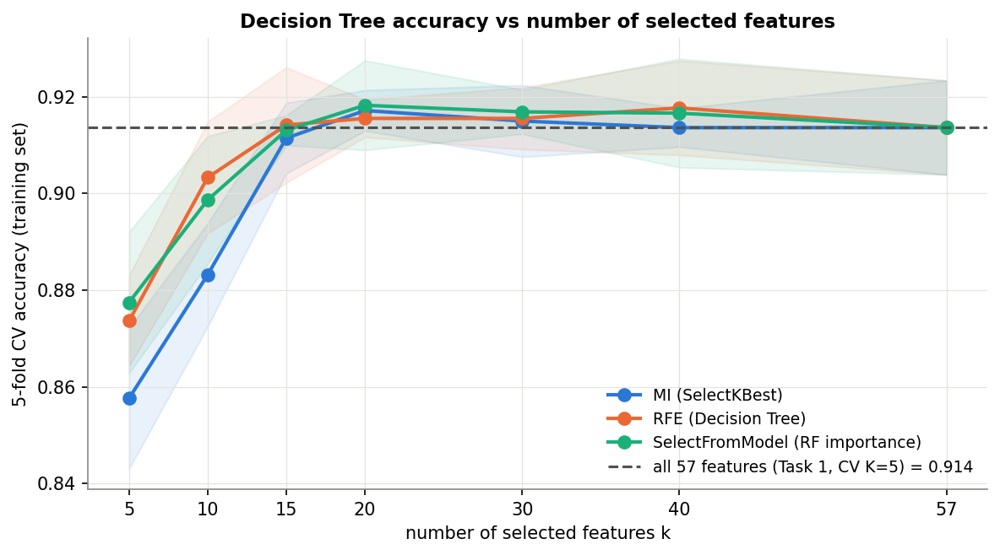

Figure 3 — 5-fold CV accuracy vs k, with the all-feature baseline from Task 1; shaded bands = CV mean ± 1 std across the 5 folds (figures/t2_accuracy_vs_k.png, tables/t2_cv_accuracy_vs_k.csv).

| method | CV-selected k | CV acc | test acc | precision | recall | F1 |
|---|---|---|---|---|---|---|
| all features (Task 1, reused) | 57 | 0.9136 | 0.9110 | 0.8828 | 0.8926 | 0.8877 |
| MI (SelectKBest) | 20 | 0.9171 | 0.9099 | 0.8933 | 0.8760 | 0.8846 |
| RFE (Decision Tree) | 40 | 0.9177 | 0.9164 | 0.8907 | 0.8981 | 0.8944 |
| SelectFromModel (RF importance) | 20 | 0.9182 | **0.9229** | 0.9056 | 0.8981 | 0.9018 |

Table 4 — Test results at the CV-selected k (tables/t2_test_results.csv).

**Interpretation (Figure 3, Table 4).**

* **k ≤ 10: worse than the baseline (under-fitting).** For example, MI with 5 features scores 0.858. MI is weakest here because it ranks features one at a time, so its top 5 includes two correlated capital-run statistics (r = 0.48 on the training set) instead of complementary words such as *remove* and *free*.
* **k = 15–40: about the same as or slightly better than the baseline** (CV 0.9114–0.9182 vs 0.9136). The 20–40 weakest features are almost always zero, and a fully grown tree uses them only to split tiny groups, which likely adds variance. Removing them is mild regularization. The gain is small because a tree already selects features implicitly.
* **k = 57** reproduces the baseline exactly.
* **Test set.** The RF-importance selector (20 features) gives the best tree (0.9229, F1 0.9018, +1.2 points), RFE +0.5 and MI −0.1 points. These differences (up to 11 e-mails) were not tested for significance and the CV gains are within one fold-std, so no selector is reliably better: the robust conclusion is that about 35% of the features reach the same accuracy.

# 6. Task 3 — Feature Extraction with PCA

Figure 4 shows the explained variance; Table 5 then compares logistic regression on the original features, on PCA components and on MI selection followed by PCA.

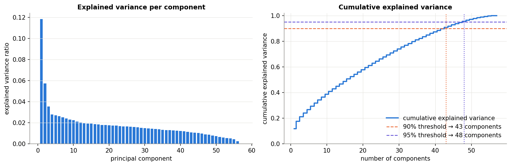{: style="width:100%"}

Figure 4 — Explained variance per component and cumulative, with 90% and 95% thresholds; StandardScaler + PCA fitted on the training set only (figures/t3_explained_variance.png, tables/t3_cumulative_variance.csv).

**Interpretation (Figure 4).** Variance is spread very evenly: PC1 explains 11.8%, 2 PCs 17.6%, 10 PCs 38.7% and 30 PCs 73.9%, and **43 of the 57 components are needed for 90% (48 for 95%)**. The features are weakly correlated, so PCA cannot compress them much. The first components capture the few correlated groups (top-8 loadings in tables/t3_pca_loadings.csv): PC1 the HP-internal vocabulary (*857, 415, telnet, labs, 650, technology*), PC2 spam words (*your, 000, $, order*), PC3 the capital-run statistics.

**Comparison.** All three set-ups use **logistic regression** (LR; L2, C=1), which is linear like PCA and needs standardized inputs:

* (a) StandardScaler → LR;
* (b) StandardScaler → PCA(n) → LR, with n ∈ {2, 5, 10, 20, 30, 43, 48, 57} chosen by CV (43 and 48 reach 90% and 95% of the training variance);
* (c) SelectKBest(MI, k) → StandardScaler → PCA(n) → LR, with k ∈ {20, 30, 40} and every n of the (b) grid with n ≤ k plus n = k, chosen by CV.

As an extra, the Task 1 Decision Tree is also run on (a) and (b).

| set-up | classifier | dims to classifier | CV acc | test acc | precision | recall | F1 |
|---|---|---|---|---|---|---|---|
| (a) original features | LR | 57 | 0.9228 | **0.9294** | 0.9209 | 0.8981 | 0.9093 |
| (b) PCA, CV-chosen n | LR | 57 | 0.9231 | **0.9294** | 0.9209 | 0.8981 | 0.9093 |
| (b') PCA, 95%-variance rule | LR | 48 | 0.9220 | 0.9273 | 0.9205 | 0.8926 | 0.9063 |
| (c) MI (k=40) → PCA (n=40) | LR | 40 | 0.9155 | 0.9262 | 0.9226 | 0.8871 | 0.9045 |
| extra (a) original | Decision Tree | 57 | 0.9136 | 0.9110 | 0.8828 | 0.8926 | 0.8877 |
| extra (b) PCA | Decision Tree | 30 | 0.8921 | 0.8817 | 0.8508 | 0.8485 | 0.8497 |

Table 5 — Original vs PCA vs selection→PCA (tables/t3_setup_comparison.csv; grid for (c) in tables/t3_fs_pca_grid.csv).

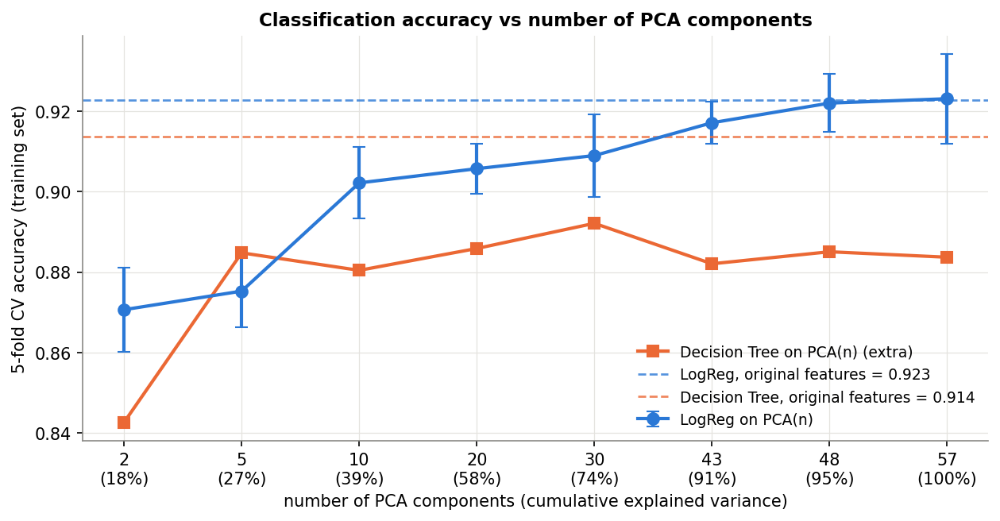

Figure 5 — CV accuracy vs number of components (cumulative variance in brackets; the grid values are evenly spaced on the x-axis, not to scale) for LR and, as an extra, the Decision Tree (figures/t3_accuracy_vs_components.png, tables/t3_cv_accuracy_vs_components.csv).

**Interpretation (Table 5, Figure 5).**

* **(b) chose no reduction.** With all 57 components PCA is just a rotation, and L2 logistic regression is rotation-invariant, so (a) and (b) give *identical* test predictions; their CV means differ by one e-mail (0.9228 vs 0.9231).
* **Real reductions cost accuracy.** With 48 components (95% variance) the test accuracy is 0.9273. With 20 components CV falls to about 0.906, and with 2 components to 0.871.
* **(c) also chose no compression.** CV picks 40 features → 40 components (test 0.9262); every compressed setting is worse (best 40 → 30, CV 0.9114, test 0.9164; tables/t3_fs_pca_compressed.csv). CV accuracy at n = k rises with every k tried (0.8957, 0.9098, 0.9155 for k = 20, 30, 40) up to the grid's largest k, so MI selection helped at no k tried; at k = 40 it costs 0.3 test points against (a).
* **PCA hurts the tree badly** (0.9110 → 0.8817). Trees rely on axis-aligned, sparse "word present?" splits, and PCA destroys them by mixing all words into every component.

| component block | variance share | CV accuracy (LR) |
|---|---|---|
| PC1–10 | 38.7% | 0.902 |
| PC11–20 | 19.0% | 0.619 |
| PC21–30 | 16.2% | 0.610 |
| PC31–57 | 26.1% | 0.629 |

Table 6 — LR trained on disjoint blocks of components (tables/t3_variance_vs_accuracy_blocks.csv).

**Does high variance guarantee better classification? No (Table 6, Figure 5).**

* Table 6 alone does not settle it: block accuracy follows block variance (38.7% → 0.902, 26.1% → 0.629, 19.0% → 0.619, 16.2% → 0.610), and the three later blocks are all close to the 0.606 majority baseline.
* The last 14 components (only 9% of the variance) still raise LR accuracy from 0.917 to 0.923 (+0.6 points; fold std 0.005 at 43 and 0.011 at 57 components, so suggestive only).
* For the tree, even all 57 components (100% of the variance, a pure rotation) score CV 0.884 against 0.914 on the original features, and its best size, 30 components (0.892), is within one fold std (0.016) of the larger sizes (0.882–0.885): keeping variance does not keep what the tree needs.

PCA is unsupervised: it ranks directions by spread, not by class separation. On Spambase it never improved accuracy (43–48 components cost LR 0.1–0.6 CV points and the tree about 3), so supervised feature selection (Task 2) is the better reduction here.

# 7. Task 4 — K-Means Clustering (Wholesale Customers)

We explore the six spending features (Table 7, Figures 6–7), compare K-Means on raw, standardized and log1p data, choose k, then compare feature spaces and profile the clusters.

| feature | mean | median | std | max | skew | skew after log1p |
|---|---|---|---|---|---|---|
| Fresh | 12,000 | 8,504 | 12,647 | 112,151 | 2.56 | −1.58 |
| Milk | 5,796 | 3,627 | 7,380 | 73,498 | 4.05 | −0.22 |
| Grocery | 7,951 | 4,756 | 9,503 | 92,780 | 3.59 | −0.67 |
| Frozen | 3,072 | 1,526 | 4,855 | 60,869 | 5.91 | −0.35 |
| Detergents_Paper | 2,881 | 817 | 4,768 | 40,827 | 3.63 | −0.24 |
| Delicassen | 1,525 | 966 | 2,820 | 47,943 | 11.15 | −1.09 |

Table 7 — Summary statistics of annual spend in m.u. (tables/t4_summary_statistics.csv).

{: style="width:100%"}

Figure 6 — Raw (top) and log1p (bottom) spending distributions (figures/t4_distributions.png).

{: style="width:52%"}

Figure 7 — Pearson correlations of the six spending features (figures/t4_correlation.png, tables/t4_correlation.csv).

**Interpretation (Table 7, Figures 6–7).**

* **Skew.** All features are heavily right-skewed (skew 2.6–11.2; means far above medians), with a few extreme spenders (max Delicassen ≈ 16.5 std above the mean). log1p makes them roughly symmetric but over-corrects Fresh and Delicassen into a left tail.
* **Scale.** Fresh alone holds 44.6% of the raw variance (tables/t4_raw_variance_share.csv).
* **Correlation.** Grocery, Detergents_Paper and Milk form a correlated "retail basket" (Grocery–Detergents_Paper r = 0.92, Milk–Grocery 0.73, Milk–Detergents_Paper 0.66), while Fresh and Frozen are nearly uncorrelated with it (|r| ≤ 0.14).

**Raw vs standardized vs log1p at k=3** (Table 7b):

| features | sizes | silhouette (own space) | silhouette (std 6-D) | ARI vs standardized |
|---|---|---|---|---|
| raw | 330/60/50 | 0.478 | 0.411 | 0.49 |
| standardized | 393/45/2 | 0.548 | 0.548 | 1.00 |
| log1p + standardized (extra) | 213/147/80 | 0.259 | 0.142 | 0.08 |

Table 7b — K-Means at k=3 on three feature representations; silhouette in each variant's own space and in the common standardized 6-D space (tables/t4_k3_raw_vs_scaled.csv). ARI = adjusted Rand index (Hubert & Arabie 1985): 1 = identical partitions, ≈ 0 = chance agreement.

On **raw features** Fresh and Grocery, the largest-scale features, decide the clusters (raw Fresh centroids 8,253 / 35,941 / 8,000). **Standardizing** weights every feature equally and changes the partition (ARI vs raw 0.49), including a 2-customer cluster of extreme spenders; own-space silhouettes are not comparable, and in the common standardized space the raw partition scores 0.411 against 0.548. **log1p** (extra) gives balanced clusters but a low silhouette and a different partition (ARI 0.08). At the chosen k=2 the raw partition is unrelated to the standardized one (ARI 0.006, sizes 375/65; tables/t4_chosen_k_raw_vs_scaled.csv).

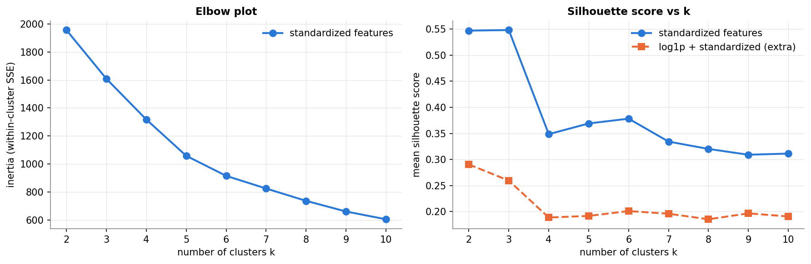{: style="width:100%"}

Figure 8 — Elbow (inertia) and silhouette (Rousseeuw 1987) for k = 2…10, standardized features, n_init=10; log1p silhouette as an extra (figures/t4_elbow_silhouette.png).

| k | 2 | 3 | 4 | 5 | 6 | 7 | 8 | 9 | 10 |
|---|---|---|---|---|---|---|---|---|---|
| inertia | 1956 | 1608 | 1318 | 1059 | 916 | 825 | 737 | 661 | 606 |
| silhouette | **0.547** | **0.548** | 0.348 | 0.369 | 0.378 | 0.334 | 0.320 | 0.309 | 0.311 |
| smallest cluster | 51 | 2 | 5 | 1 | 1 | 1 | 1 | 1 | 1 |

Table 8 — K sweep (tables/t4_k_sweep.csv).

**Choosing k (Figure 8, Table 8).**

* **Elbow:** inertia falls smoothly (−18%, −18%, −20%, then −14% to −8% per step): no sharp elbow, only a weak flattening after k ≈ 5–6.
* **Silhouette:** k=2 (0.547) and k=3 (0.548) are clearly best and tied (Δ = 0.001); every k ≥ 4 scores at most 0.378 (k=6), at least 0.169 below k=2.
* **Cluster size** separates the tied pair: k=3's extra cluster holds only **2 customers**, and k ≥ 5 has one-customer clusters.

**The evidence favours k = 2**, and on data capped at the 99th percentile silhouette picks it outright (Table 10b). As a tie-breaker we used an explicit rule: take the k with silhouette within 0.01 of the best whose smallest cluster holds at least 5% of customers, which selects **k = 2** (clusters 389/51). The rule is *post hoc* (Section 9) and the 5% threshold is a judgement call, so the capping check tests it. Rejected: k=3 (a two-outlier cluster), k=5–6 (elbow region, but silhouette 0.17–0.18 lower and singleton clusters) and log1p clustering (balanced, but best silhouette 0.29).

{: style="width:100%"}

Figure 9 — Clusters in PCA(2) space with centroids (✕); chosen k=2 (top) and alternative k=3 (bottom). Colour and marker follow the segment (blue circles = dense cloud, orange squares = retail tail, green triangles = the two outliers); K-Means numbers clusters arbitrarily, so the dense cloud is cluster 0 at k=2 and cluster 1 at k=3. One PC2 unit is drawn about 4× shorter than one PC1 unit (figures/t4_pca_clusters.png).

**Interpretation (Figure 9).** PC1 (44% of variance) loads on Milk, Grocery and Detergents_Paper, and PC2 (28%) on Fresh, Frozen and Delicassen. With k=2, cluster 1 is the long tail of heavy retail-basket buyers along PC1 and cluster 0 the dense cloud near the origin; the boundary cuts a continuous tail, hence a silhouette of only about 0.55. With k=3 the two extreme points high on PC2 get their own centroid, in empty space between them (one came from each k=2 cluster), and a few retail-tail customers move to the dense cluster (389 → 393, retail tail 51 → 45, plus the 2 outliers).

| features | dims | silhouette (own space) | silhouette (std 6-D) | sizes | smallest/largest size | ARI vs (a) |
|---|---|---|---|---|---|---|
| (a) original 6, standardized | 6 | 0.547 | 0.547 | 389/51 | 0.13 | 1.00 |
| (b) selected 5 (Grocery dropped) | 5 | 0.722 | 0.725 | 424/16 | 0.04 | 0.37 |
| (c) PCA, 2 components | 2 | 0.636 | 0.563 | 395/45 | 0.11 | 0.91 |
| (c) PCA, 3 components (≥80% var) | 3 | 0.578 | 0.547 | 389/51 | 0.13 | 1.00 |
| extra: log1p + standardized | 6 | 0.290 | 0.261 | 252/188 | 0.75 | 0.13 |

Table 9 — Clustering at k=2 in different feature spaces (tables/t4_feature_space_comparison.csv).

**Interpretation (Table 9).** Selection rule for (b), using only the correlations between the six spending features and no clustering result: while some |r| > 0.7, drop the member of the most-correlated pair with the larger mean |r|. This removed Grocery (any cut-off between 0.67 and 0.92 does), but the tie-break is close (mean |r| 0.382 vs 0.378 for Detergents_Paper) and only this subset was tested, so row (b) describes this subset, not feature selection in general.

* **(b) selected features.** The silhouette rises to 0.72, but only because the clustering now isolates a 16-customer group of extreme spenders (balance 0.04, ARI 0.37). Grocery is one of two near-duplicate retail features (r = 0.92 with Detergents_Paper), so removing it weakens the retail axis and, in this subset, the outlier directions dominate. A higher silhouette is not a better segmentation here.
* **(c) PCA.** PCA with 2 components keeps almost the same partition (ARI 0.91) and gives a slightly better 6-D silhouette (0.563). PCA with 3 components reproduces (a) exactly. The structure lives in the first PCs.
* **log1p (extra)** is the most balanced option but the least separated.

| cluster | n (share) | Fresh | Milk | Grocery | Frozen | Det._Paper | Delicassen | total | Horeca / Retail (post-hoc) |
|---|---|---|---|---|---|---|---|---|---|
| 0 | 389 (88%) | 12,157 | 4,028 | 5,403 | 3,066 | 1,668 | 1,257 | 27,579 | 293 / 96 |
| 1 | 51 (12%) | 10,803 | 19,282 | 27,390 | 3,117 | 12,140 | 3,569 | 76,301 | 5 / 46 |

Table 10 — Unscaled per-cluster mean spend in m.u. (tables/t4_cluster_profiles.csv; medians in tables/t4_cluster_medians.csv; Channel crosstab in tables/t4_channel_crosstab_posthoc.csv — Channel was not used for fitting).

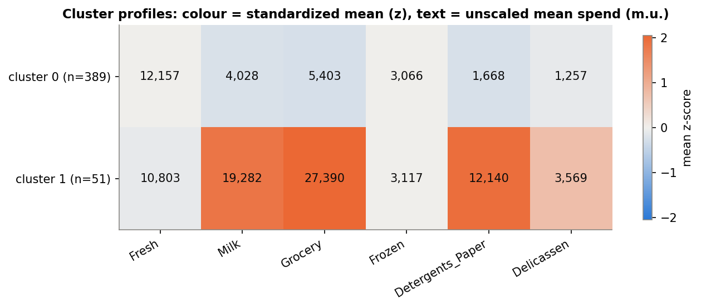{: style="width:80%"}

Figure 10 — Cluster profiles: colour = standardized mean, text = unscaled mean in m.u. (figures/t4_cluster_profile_heatmap.png).

**Interpretation (Table 10, Figure 10).**

* **Cluster 0 — "fresh-oriented Horeca and small shops"** (88%): average spend 27.6k, Fresh the largest category, packaged goods low.
* **Cluster 1 — "large retail / grocery-basket buyers"** (12%): average spend 76.3k (2.8×), with Grocery 5×, Milk 4.8×, Detergents_Paper 7.3× and Delicassen 2.8× the levels of cluster 0, while Fresh and Frozen are similar. The medians agree (Grocery 22,294 vs 3,823), so the profile is not an outlier artefact.
* **Post-hoc check:** 90% of cluster 1 is *Retail* and 75% of cluster 0 is *Horeca*, but cluster 1 holds only 46 of the 142 retailers: the clusters agree with Channel for 77% of customers, against 68% for always guessing Horeca. The volume-based split separates high-volume retail buyers and only partly recovers the business distinction; the retailers in cluster 0 buy a retail mix in smaller volumes. Of the Table 9 partitions, log1p, the least separated, agrees best with Channel (86%; tables/t4_channel_agreement_by_space.csv).

**Difficulties and the effect of scaling and dimensionality reduction.** Heavy skew and outliers break K-Means' assumption of compact, similar-sized clusters, and silhouette rewards isolating outliers. Scaling was essential (without it the largest-scale features, Fresh and Grocery, decided the clustering); log1p answers a different question (relative spending pattern rather than volume) and finds weak structure; PCA preserved the clustering, while dropping Grocery changed it substantially.

| version | customers capped | best silhouette (k) | silhouette k=3 | k chosen by the rule | sizes at k=2 | ARI vs chosen partition | Retail share of retail cluster |
|---|---|---|---|---|---|---|---|
| standardized (Table 8) | 0 | 0.548 (3) ≈ 0.547 (2) | 0.548 | 2 | 389/51 | 1.00 | 90% |
| capped at 99th pct., standardized | 19 | **0.463 (2)** | 0.395 | 2 | 373/67 | 0.80 | 90% |

Table 10b — Robustness check: K-Means after capping each feature at its 99th percentile (tables/t4_capped_k_sweep.csv, tables/t4_capped_profiles.csv).

**Interpretation (Table 10b).** With the 19 most extreme customers capped, **k=2 wins on silhouette alone** (0.463 vs 0.395) with no tiny cluster, so the post-hoc size rule is no longer needed. The segmentation is the same one (ARI 0.80): the retail group grows from 51 to 67 customers and keeps its profile (about 5× Grocery, 7× Detergents_Paper, 90% Retail). The outliers explain most instability (bootstrap ARI 0.56, capped 0.85; tables/x4_bootstrap_stability_capped.csv) and the spurious k=3, not the main result.

# 8. Task 5 — Decision Trees and Ensembles

**Models and search.** Decision Tree, Random Forest (Breiman 2001), XGBoost (Chen & Guestrin 2016), Gradient Boosting (Friedman 2001) and AdaBoost (SAMME, Zhu et al. 2009) with stumps as a fixed base learner, all tuned by `GridSearchCV` with 5-fold stratified CV on the training set (full grids in tables/t5_search_decision_tree.csv, tables/t5_search_random_forest.csv, tables/t5_search_xgboost.csv, tables/t5_search_gradient_boosting.csv and tables/t5_search_adaboost.csv).

| model | grid | best setting | CV acc | CV std | CV train acc |
|:---|:---|:---|---:|---:|---:|
| Decision Tree | max_depth ∈ &#123;2,3,4,5,6,8,10,12,15,20,None&#125; | max_depth=12 | 0.9226 | 0.008 | 0.9758 |
| Random Forest | n_estimators ∈ &#123;100,300,500&#125; × max_depth ∈ &#123;5,10,20,None&#125; | 300 trees, no depth limit | 0.9527 | 0.005 | 0.9998 |
| XGBoost | n_estimators ∈ &#123;100,300,500&#125; × lr ∈ &#123;0.01,0.05,0.1,0.3&#125; × max_depth ∈ &#123;3,5,7&#125; | 300 trees, lr 0.1, depth 7 | **0.9576** | 0.009 | 0.9995 |
| Gradient Boosting | n_estimators ∈ &#123;100,300&#125; × lr ∈ &#123;0.05,0.1&#125; × max_depth ∈ &#123;3,5&#125; | 300 trees, lr 0.1, depth 5 | 0.9549 | 0.007 | 0.9991 |
| AdaBoost (stumps) | n_estimators ∈ &#123;100,300,500&#125; × lr ∈ &#123;0.5,1.0&#125; | 300 stumps, lr 1.0 | 0.9424 | 0.005 | 0.9526 |

Table 11 — Hyper-parameter search results (tables/t5_best_params.csv); CV std from GridSearchCV (ddof = 0).

**Interpretation (Table 11).** The tree's depths 10, 12 and 15 are within 0.002 in CV (0.9212–0.9226), while depths 2–3 under-fit (0.87–0.89). Random Forest works best with unlimited depth (depth 5 under-fits, 0.93), and the number of trees barely matters. XGBoost's three worst settings (lr 0.01 with 100 trees, CV 0.915–0.930) are under-trained, and its top three lie within 0.00054 (0.9571–0.9576).

| rival (its grid size) | rival best CV | XGBoost best CV, same budget (median [5th pct.]) | XGBoost ahead |
|---|---|---|---|
| Random Forest (12) | 0.9527 | 0.9573 [0.9562] | 100% |
| Gradient Boosting (8) | 0.9549 | 0.9571 [0.9554] | 96% |
| AdaBoost (6) | 0.9424 | 0.9571 [0.9541] | 100% |

Table 11b — Equal-budget check: best CV score of 2,000 random subsets of XGBoost's 36-setting grid, each the size of the rival's grid; stored CV scores only, no refits (tables/t5_budget_matched.csv).

**Interpretation (Table 11b).** With as many settings as each rival, XGBoost still leads in 96–100% of draws, so its lead is not an artefact of grid size, but it does depend on grid range: on Gradient Boosting's 8 settings XGBoost's best CV is 0.9533, below Gradient Boosting's 0.9549 (tables/t5_search_xgboost.csv). All 11 XGBoost settings above 0.9549 use depth 7, lr 0.3 or 500 trees, which Gradient Boosting was not offered, and Gradient Boosting's best setting sits on the upper edge of all three of its ranges (as does XGBoost's depth 7). Appendix A.5 moves each of these parameters past its edge.

| model | CV acc | test acc | precision | recall | F1 | FP | FN |
|---|---|---|---|---|---|---|---|
| Decision Tree (depth 12) | 0.9226 | 0.9197 | 0.9070 | 0.8871 | 0.8969 | 33 | 41 |
| Random Forest | 0.9527 | 0.9457 | **0.9510** | 0.9091 | 0.9296 | 17 | 33 |
| **XGBoost** | 0.9576 | **0.9468** | 0.9337 | **0.9311** | **0.9324** | 24 | 25 |
| Gradient Boosting | 0.9549 | 0.9457 | 0.9335 | 0.9284 | 0.9309 | 24 | 26 |
| AdaBoost (stumps) | 0.9424 | 0.9294 | 0.9209 | 0.8981 | 0.9093 | 28 | 37 |

Table 12 — Test-set metrics of the CV-selected models (tables/t5_test_metrics.csv); FP/FN from the confusion matrices. AdaBoost's row equals Task 3's logistic regression (a) in Table 5 by coincidence: both make 28 false positives and 37 false negatives.

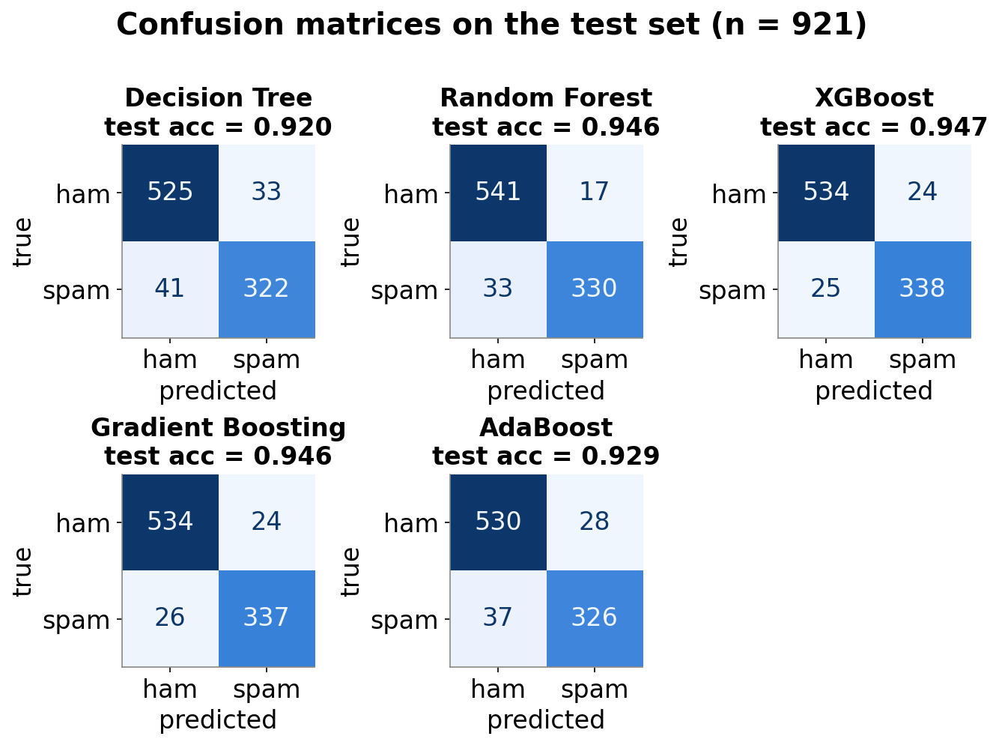

Figure 11 — Test-set confusion matrices of the five tuned models, 2 × 3 grid with the last panel empty; rows = true class, columns = predicted class (figures/t5_confusion_matrices.png).

**Interpretation (Table 12, Figure 11).**

* **XGBoost is the CV-selected model** (CV 0.9576 vs 0.9549 for Gradient Boosting). On the test set it scores accuracy 0.9468 and F1 0.9324, with 49 errors in 921 e-mails, evenly split between false positives and false negatives.
* **RF and GB are within one e-mail** of XGBoost, far inside the test standard error (about 0.7 points): the top three are not significantly different (Table 15), and with newer package versions Gradient Boosting scores higher than XGBoost (README), so "best" means "selected by CV in this pinned run".
* **RF has the highest precision** (only 17 legitimate e-mails flagged), which a real spam filter might prefer.
* The CV ranking matches the test ranking apart from a tie (RF and GB both 0.9457), and each test score is 0.003–0.013 below its CV estimate: partly selection optimism (a CV maximum over the grid; nested CV puts it at 0.1–0.5 points, Table 16), partly test-set sampling error (standard error about 0.7–0.9 points). AdaBoost, with the smallest grid, drops most (1.3 points).

{: style="width:100%"}

Figure 12 — Complexity curves: Decision Tree train/test/CV accuracy vs max_depth (left); XGBoost CV train/validation accuracy vs max_depth plus, as an illustration not used for selection, the test accuracy of one full-training-set fit per depth (right); bands = CV validation mean ± 1 std over the 5 folds (figures/t5_complexity_curves.png, tables/t5_complexity_decision_tree.csv, tables/t5_complexity_xgboost.csv with the test_acc column).

**Interpretation (Figure 12).** Over-fitting here means validation accuracy falling as complexity grows; a train–test gap alone is not the criterion.

* **Decision Tree, depths 1–4: under-fitting.** Training, CV and test accuracy are all low and close together (depth 1: 0.80 / 0.80 / 0.77).
* **Decision Tree, beyond depth ≈ 12: over-fitting.** Training accuracy keeps rising to 0.996 while CV and test accuracy flatten and decline slightly; the train–validation gap grows from 0.01 (depth 3) to 0.05 (depth 12) to 0.08 (depth 25).
* **XGBoost:** stumps under-fit (0.944), because they cannot model interactions, but there is no real over-fitting: validation accuracy improves up to depth 7–9 (0.958) and stays flat while training accuracy reaches 0.9995, since shrinkage (lr 0.1) makes each tree a small correction.
* **Train vs test:** XGBoost's test-accuracy line stays within 0.938–0.951 and is flat from depth 4 on (0.946–0.949), so the test set shows no over-fitting either. Across the five models, the gap between training-set and test accuracy (tables/t5_train_vs_test.csv) is 5.6 points for the Decision Tree and 5.2–5.4 points for Random Forest, XGBoost and Gradient Boosting, which fit the training set even more closely (0.9992–0.9997 vs 0.9758) yet score higher on the test set (F1 gaps 6.7–7.2 points for these four). AdaBoost has the smallest gap (2.2 points) but also the lowest training accuracy (0.9514), the under-fitting pattern of its stumps.

| model | variant | CV-chosen setting | CV acc | test acc | F1 |
|---|---|---|---|---|---|
| Random Forest | baseline | – | 0.9527 | 0.9457 | 0.9296 |
| Random Forest | (a) MI selection | k=40 | 0.9514 | 0.9446 | 0.9285 |
| Random Forest | (b) PCA | n=40 | 0.9323 | 0.9164 | 0.8923 |
| XGBoost | baseline | – | 0.9576 | 0.9468 | 0.9324 |
| XGBoost | (a) MI selection | k=40 | 0.9549 | 0.9479 | 0.9335 |
| XGBoost | (b) PCA | n=30 | 0.9383 | 0.9240 | 0.9033 |

Table 13 — Random Forest and XGBoost with feature selection or PCA inside the pipeline (tables/t5_fs_pca_comparison.csv). Grids: k ∈ {10, 20, 30, 40}, n ∈ {10, 20, 30, 40}; hyper-parameters reused from Table 11, not retuned (Appendix A.5 retunes max_depth with PCA and an RF-importance selector).

{: style="width:75%"}

Figure 13 — Test accuracy, baseline vs feature selection vs PCA, as a dot plot with each value labelled (figures/t5_fs_pca_comparison.png).

**Interpretation (Table 13, Figure 13).**

* **Feature selection is neutral** (±0.1 points on the test set). CV chose the largest k offered (40), and the all-feature baseline scores higher in CV than k = 40 for both models (0.9527 vs 0.9514, 0.9576 vs 0.9549), so no selection helps in CV. The ensembles already ignore weak features through random feature subsets and gain-based splits.
* **PCA costs 2.3–2.9 test points** for the same reason as in Task 3: tree ensembles depend on sparse, axis-aligned word splits that PCA mixes away. CV chose the largest n offered for Random Forest (40) and n = 30 for XGBoost; larger n was not tried here.

**Why the models differ.**

* **Single tree:** a deep tree has low bias and high variance, which is why it reaches only 0.91–0.92; its noisy splits on mostly-zero words are what ensembles average out.
* **Bagging (RF):** averages 300 de-correlated full-depth trees, removing much of that variance, for +2.6 test points.
* **Boosting (XGBoost, GB):** fits trees sequentially to the residual errors, which lowers bias, while shrinkage and moderate depth (5–7) keep variance in check. XGBoost's small CV edge over Gradient Boosting comes from settings Gradient Boosting's grid did not include (Table 11b), and on the test set the two do not differ (McNemar 9 vs 8, Table 15).
* **AdaBoost** ran with stumps only (base depth not tuned), which cannot represent interactions such as "*free* AND long capital runs", so it under-fits; XGBoost limited to depth 1 scores about the same in CV (0.944, Figure 12, vs 0.942). Its lower rank reflects the stumps rather than AdaBoost as such: with depth-5 base trees (the deepest tried) it reaches CV 0.9579, level with XGBoost's 0.9576 (Appendix A.5).
* **Class imbalance (61/39)** is mild. Precision and recall stay within about 4 points for all models (largest gap 4.2 points, Random Forest), so we did not try class re-weighting.

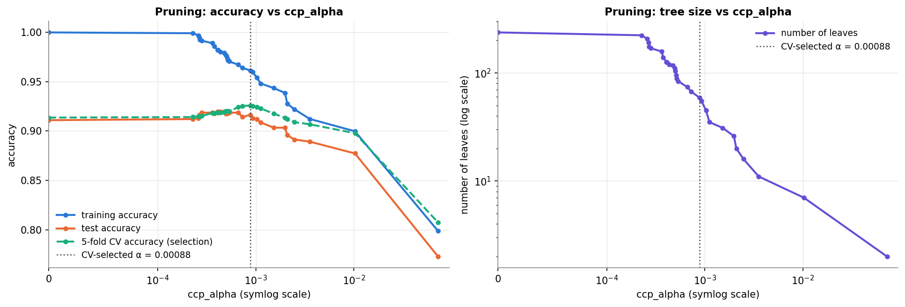{: style="width:100%"}

Figure 14 — Cost-complexity pruning: accuracy (left) and number of leaves (right) vs ccp_alpha (figures/t5_ccp_pruning.png, tables/t5_ccp_alpha.csv).

| tree | leaves | test acc | F1 |
|---|---|---|---|
| unpruned (Task 1 baseline, reused) | 237 | 0.9110 | 0.8877 |
| max_depth = 12 (from the search above, reused) | 120 | 0.9197 | 0.8969 |
| **ccp_alpha = 0.00088 (CV-best)** | **59** | 0.9164 | 0.8926 |
| ccp_alpha = 0.00112 (1-SE rule, extra) | 35 | 0.9088 | 0.8814 |

Table 14 — Pruning summary (tables/t5_pruning_summary.csv).

**Pruning (Figure 14, Table 14).** The training-set pruning path has 106 distinct α values (without the last, which prunes to the root); we evaluated 30 evenly spaced quantiles of it, starting at α = 0.

* **CV accuracy** rises from 0.9136 (α = 0) to **0.9258 at α = 0.00088**, then collapses as the tree becomes too small (0.81 at 2 leaves).
* **Tree size:** the chosen tree has 59 leaves, 75% fewer than the unpruned tree, and test accuracy 0.9164 vs 0.9110. It is about as accurate as the depth-limited tree (test 0.9164 vs 0.9197, 3 e-mails; CV 0.9258 vs 0.9226) with half as many leaves.
* **Test curve:** it peaks at a slightly smaller α (0.9197); that peak was not used for selection.
* **1-SE rule (extra):** the simplest tree whose CV accuracy is within one standard error of the best (Breiman et al. 1984) has 35 leaves and costs 0.8 test points.

# 9. Challenges and unsuccessful attempts

* **XGBoost and feature names.** The first full run failed in Task 5 because XGBoost rejects names such as `char_freq_[`. *Fix:* `load_spambase` renames the six symbol features (e.g. `char_freq_dollar`).
* **Package versions.** Newer releases (tested: scikit-learn 1.9.1, pandas 3.1.1) run but change some numbers, including which ensemble scores best on the test set, so the versions that produced every result are pinned (`requirements.txt`, `constraints.txt`; README).
* **Task 4: choice of k.** Our first draft hard-coded k=3 (highest silhouette), whose third cluster held 2 customers. The size rule of Section 7 (which selects k=2) was written after seeing that, so we added the capping check rather than rely on the rule alone; k=2 also proved less stable than hoped (Appendix A.4).
* **Task 3: unequal grids.** Set-up (c) was first searched only over n ≤ 20 components while (b) could use 57; (c) now uses every n of the (b) grid up to its input size, plus n = k, and CV then chose no compression at all.
* **Task 3: PCA selected 57 of 57 components** (no reduction), so we added the 95%-variance variant to report a real reduction, which was slightly worse (test 0.9273 vs 0.9294 for (a)).
* **Task 5: unequal tuning budgets** (XGBoost 36 settings, RF 12, GB 8). The equal-budget check of Section 8 replaced re-tuning everything; it matches grid size, not range (Table 11's Gradient Boosting grid never tried depth 7; Appendix A.5 does).
* **Worse settings, kept in the tables:** the unpruned tree; K=3 CV; k ≤ 10 features; MI selection; MI→PCA; PCA for DT, RF and XGBoost; AdaBoost with stumps; XGBoost with lr 0.01 and 100 trees; RF with depth 5; the correlation-selected and log1p clusterings; the 1-SE pruned tree; the gap statistic.

# 10. Reused results and verification

**Reused results.** One split serves Tasks 1, 2, 3 and 5. The Task 1 all-feature tree is the baseline of Figure 3, Tables 4–5 and the pruning path (α = 0); Task 2's seeded MI scorer is reused in Task 3 (c) and Table 13; Task 4's matrices and chosen k feed Table 9, and its k rule and k=2 partition (the ARI reference) the capping check; the tuned Task 5 settings feed Figure 12, Tables 13–14 and the equal-budget check (stored CV scores, no refits). Appendix A reuses the fitted Task 5 models, the Task 2 rankings and the Task 4 data and k; Figure 0 re-plots Tasks 1–5.

**Verification.**

* **Leakage:** every `fit`/`fit_transform` call on Spambase uses `X_train` or runs inside a CV-evaluated `Pipeline`. The test set is never passed to `fit`; besides predictions and scores it appears only in descriptive summaries (Table 1, Section 2's duplicate count, A.5's copy flag) and in two Appendix A analyses that fit nothing (A.2's error-analysis means, A.3's permutation importance).
* **Reproducibility:** with the pinned packages, the headline table tables/summary_key_results.csv is identical on Windows and Linux with Python 3.12 and 3.13 (CI) and with the uv install route; the other tables agree up to floating-point rounding and timing columns, except four that differ slightly on Linux and 17 not compared there (README, Reproducibility). All results in this report, apart from the reproducibility comparisons, come from one Windows run with Python 3.12. The final version was executed after the last code change, with 0 errors.
* **Coverage:** all 23 figures in `figures/` appear in the notebook and in this report with an interpretation, and every one of the 67 CSVs in `tables/` is interpreted in the notebook and referenced in this report.

# 11. Conclusions

* **Cross-validation.** 5- or 10-fold CV gives a slightly less biased and clearly more stable estimate than 3-fold CV or a single split, at the cost of K model fits.
* **Feature selection.** About 20 of the 57 features (`$`, `!`, capital runs, *free/remove*, the ham markers *hp/george*) are enough; at their CV-selected k the three selectors differ by less than one fold-std in CV (no significance test was run), and univariate MI is clearly weaker only at k ≤ 10.
* **PCA** compresses Spambase poorly (43 PCs for 90% variance) and never improved classification: 43–48 components cost LR 0.1–0.6 CV points, and even all 57 cost the tree 3.
* **Clustering.** Standardized K-Means finds a large fresh-oriented Horeca/small-shop segment and a high-volume retail segment; outliers, skew and scaling strongly influence it, and capping the 19 most extreme customers confirms k=2 and the same split.
* **Ensembles.** RF, GB and XGBoost significantly beat the depth-tuned single tree; AdaBoost with stumps does not. **XGBoost** is the CV-selected model (test accuracy **0.9468**, F1 **0.9324**), not significantly different from RF and GB. The single tree under-fits at depth ≤ 4 and over-fits beyond depth 12, XGBoost does not over-fit across the depths tried, and AdaBoost's stumps under-fit (deeper base trees close the gap, Appendix A.5). MI selection leaves the ensembles unchanged (±0.1 points), PCA costs them 2.3–2.9 test points, and pruning made a single tree 75% smaller at slightly better accuracy.
* **Extras (Appendix A).** Confidence intervals and nested CV show which differences are established, a cost-aware threshold cuts lost legitimate e-mails from 24 to 4, and the explanations confirm the dependence on the mailbox owner's vocabulary that the dataset donors describe.

# Appendix A — Additional analyses (beyond the required tasks)

These checks go beyond the tasks. They use the same split and the fitted Task 5 models, and every choice is still made on training data. A.1–A.4 correspond to the notebook sections X1–X4, A.5 to section R; Figure 0 is X5.

## A.1 Are the Task 5 differences real?

Paired bootstrap confidence intervals (Efron & Tibshirani 1993), exact McNemar tests with Holm correction and nested CV test whether the Task 5 differences exceed test-set noise.

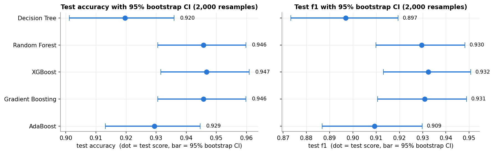{: style="width:100%"}

Figure 15 — Test accuracy and F1 with 95% paired-bootstrap CIs, 2,000 resamples (figures/x1_bootstrap_ci.png, tables/x1_bootstrap_ci.csv).

| comparison | accuracy difference [95% CI] | McNemar: XGBoost right & other wrong vs XGBoost wrong & other right | Holm p |
|---|---|---|---|
| XGBoost − Decision Tree | +0.027 [+0.011, +0.045] | 43 vs 18 | 0.017 |
| XGBoost − AdaBoost (stumps) | +0.017 [+0.005, +0.029] | 24 vs 8 | 0.049 |
| XGBoost − Random Forest | +0.001 [−0.010, +0.011] | 12 vs 11 | 1.000 |
| XGBoost − Gradient Boosting | +0.001 [−0.008, +0.010] | 9 vs 8 | 1.000 |

Table 15 — Paired bootstrap differences and exact McNemar tests (McNemar 1947) with Holm correction (Holm 1979) (tables/x1_bootstrap_accuracy_difference.csv, tables/x1_mcnemar.csv; all 10 pairs in the CSV).

| model | non-nested CV | nested CV (mean ± std) | optimism | test accuracy |
|---|---|---|---|---|
| Decision Tree | 0.9226 | 0.9215 ± 0.010 | +0.0011 | 0.9197 |
| Random Forest | 0.9527 | 0.9500 ± 0.006 | +0.0027 | 0.9457 |
| XGBoost | 0.9576 | 0.9524 ± 0.011 | +0.0052 | 0.9468 |

Table 16 — Nested 5×5 cross-validation on the training set (tables/x1_nested_cv.csv).

**Interpretation (Figure 15, Tables 15–16).**

* Each test accuracy is known only to about ±1.5 points (1.4–1.8). XGBoost is significantly better than the Decision Tree but **not significantly different from Random Forest and Gradient Boosting** (the 95% CIs still allow differences of about ±1 point). Its lead over AdaBoost (stumps) is narrow and not robust: on all 921 e-mails the paired-bootstrap interval (+0.5 to +2.9 points, not corrected for multiple comparisons) excludes zero and McNemar gives Holm p = 0.049, but on the 817 test e-mails without a copy in the training set (Section 2) the lead shrinks to 19 vs 8 discordant e-mails (exact p = 0.052, Holm p = 0.37; Appendix A.5), so we do not treat it as established. The defensible ranking is {XGBoost ≈ GB ≈ RF} ≥ AdaBoost (stumps) ≥ Decision Tree: after Holm, RF, GB and XGBoost each beat the tree, and no difference among the four ensembles is established.
* The nested-CV results are consistent with a small optimism of the tuned CV score, which is a maximum over the grid: +0.1, +0.3 and +0.5 points for 11, 12 and 36 settings. Each gap is below the nested-CV std (0.6–1.1 points), so they do not establish a trend with grid size. The nested ranking agrees (XGBoost 0.9524, RF 0.9500, DT 0.9215), but the XGBoost–RF gap (0.24 points) is well inside the nested std, and Gradient Boosting, the CV runner-up, was not run nested.

## A.2 The model as a real spam filter

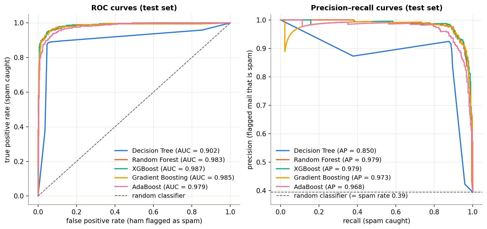{: style="width:100%"}

Figure 16 — ROC and precision–recall curves on the test set (figures/x2_roc_pr_curves.png, tables/x2_auc.csv).

**Interpretation (Figure 16).** The ensembles rank e-mails almost perfectly (ROC AUC 0.979–0.987, average precision 0.968–0.979). The Decision Tree (AUC 0.902) outputs only a few distinct leaf probabilities, so its best precision at 90% recall or more is only 0.42. The precision–recall curves are drawn as steps between operating points (the convention behind average precision), so the tree's few thresholds show as a few flat steps.

{: style="width:80%"}

Figure 17 — Out-of-fold training cost vs decision threshold (false positive = 10, false negative = 1); black-edged marks = chosen thresholds (the small marks only tell the lines apart; XGBoost's chosen triangle (0.95) sits partly under Gradient Boosting's diamond (0.94)). The y-axis is cut above the chosen costs, so the Random Forest and AdaBoost curves leave the plot at low thresholds (figures/x2_cost_vs_threshold.png).

| model | threshold (chosen on training OOF) | test FP | test FN | cost per 1,000 e-mails | test accuracy |
|---|---|---|---|---|---|
| XGBoost | 0.50 (default) | 24 | 25 | 288 | 0.947 |
| **XGBoost** | **0.95** | **4** | 58 | **106** | 0.933 |
| Random Forest | 0.74 | 4 | 65 | 114 | 0.925 |

Table 17 — Cost-sensitive thresholds (tables/x2_cost_threshold.csv; all five models in the CSV).

**Interpretation (Figure 17, Table 17).** Losing a real e-mail is worse than seeing a spam, so a false positive is assumed to cost 10 false negatives (an assumption; the ratio was not varied). Choosing the threshold on out-of-fold *training* predictions cuts XGBoost's false alarms from 24 to **4** of 558 legitimate e-mails and its cost by **63%**, although accuracy drops 1.4 points. Accuracy treats both errors as equal, so it is the wrong metric for this decision. The Decision Tree's default row in tables/x2_cost_threshold.csv has 34 false positives, one more than Table 12, because one legitimate test e-mail sits in a leaf with P(spam) exactly 0.5 (`predict()` says ham, the rule P(spam) ≥ 0.5 says spam).

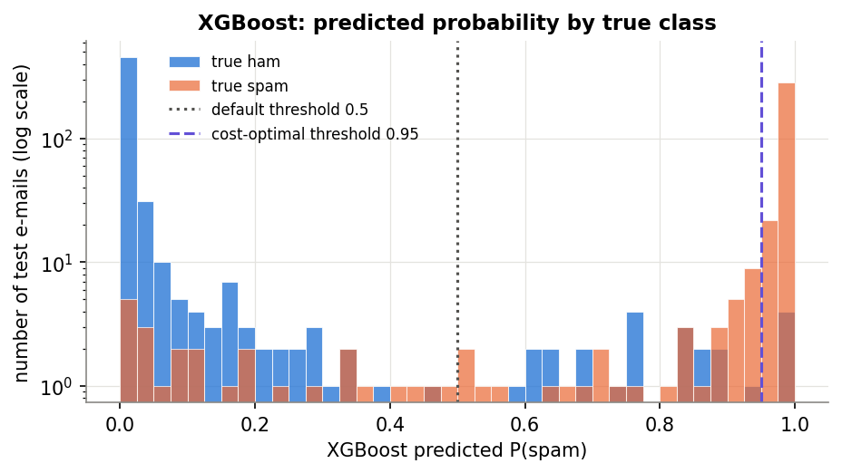{: style="width:80%"}

Figure 18 — XGBoost test probabilities by true class, log scale; where both classes fall in a bin the bars overlap (brown) (figures/x2_probability_histogram.png; feature profile of each confusion cell in tables/x2_error_analysis.csv).

**Error analysis (Figure 18).** The profile uses XGBoost's own eight most important features (built-in importance of its training fit), then the rest of Task 2's RF top 8. Most e-mails sit at the two ends of the probability scale. Of the 25 missed spam e-mails, 17 get P(spam) below 0.25 (11 below 0.1; tables/x2_errors_by_probability_band.csv), so most are not borderline: they are "quiet", with 11× fewer `$`, almost no *remove* and short capital runs, and they carry ham markers (*edu* 0.32 vs 0.01, *hp* 0.093 vs 0.005; mean P(spam) 0.18). False alarms are ham that sounds like spam: 7× more `!` and 8× more *free* than normal ham (mean P(spam) 0.80); the 4 ham e-mails at or above 0.95 are the false positives left at the cost-optimal threshold (Table 17; tables/x2_errors_by_probability_band.csv). This suggests that fixing these errors needs new information (headers, sender, full text) more than a better model (only XGBoost's errors were profiled).

## A.3 Explaining the best model

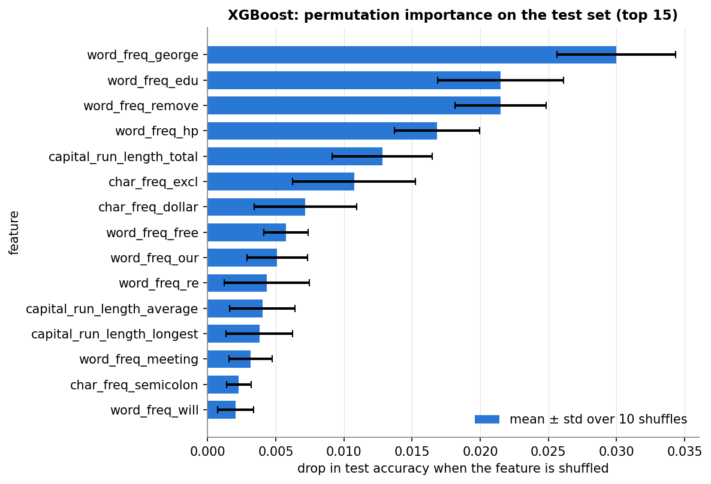{: style="width:75%"}

Figure 19 — XGBoost permutation importance on the test set, 10 repeats (figures/x3_permutation_importance.png, tables/x3_permutation_importance.csv).

**Interpretation (Figure 19).** Three of the four most important features are *ham* markers: *george* (−3.0 accuracy points when shuffled), *edu* (−2.1) and *hp* (−1.7); only *remove* (−2.1) is a spam marker. `$` and `!` flag most spam, and the ham markers suggest that the model resolves the remaining hard cases with the mailbox owner's personal vocabulary. The classifier is partly personalized to one mailbox, a dataset-shift risk the test score (same mailbox) cannot reveal; the dataset's donors already note that *george* marks non-spam and suits a personalized filter (Hopkins et al. 1999). Shuffling one feature of a correlated group such as *hp, hpl, 650, labs, 857, 415, telnet* understates the importance of the group as a whole. Refitting the tuned models without the six mailbox-specific words (*george* and the area code *650*, which UCI's notes name as signs of the donor's own mail, and *hp, hpl, lab, labs*, which name the donor's employer; *edu* is not on the list; tables/x3_mailbox_words_removed.csv) costs 0.95 CV points for RF and 1.55 for XGBoost; on the test set RF loses 0.98 points and XGBoost none.

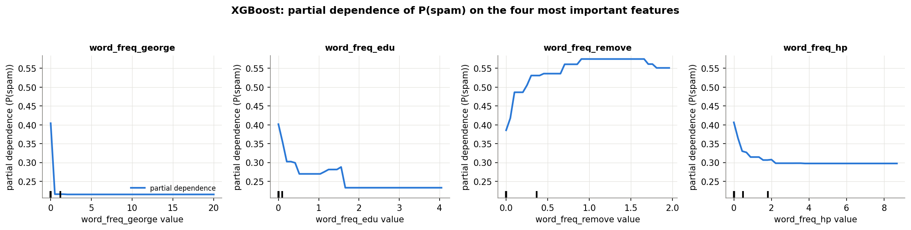{: style="width:100%"}

Figure 20 — Partial dependence of P(spam) on the four most important features by test-set permutation importance (Figure 19); black ticks on the x-axes mark the training-set deciles (figures/x3_partial_dependence.png).

**Interpretation (Figure 20).** All four effects are non-linear, saturating and nearly monotone (the smallest non-zero *george* frequency on the plot's grid drops the average P(spam) from 0.40 to 0.22; *remove* raises it to about 0.57). The exceptions are two small bumps: *edu* rises slightly just before its drop near frequency 1.6%, and *remove* falls back slightly at the top of its range. Trees represent such steps naturally; the linear model of Task 3 cannot on untransformed inputs, which may be part of why it scores lower (0.929 vs 0.947; not tested).

{: style="width:100%"}

Figure 21 — Learning curves, 5-fold CV on the training set; shaded band = CV validation mean ± 1 std across the 5 folds (figures/x3_learning_curves.png, tables/x3_learning_curves.csv).

**Interpretation (Figure 21).** The single tree is still improving at full size (0.867 → 0.923), while XGBoost and RF flatten after about 2,000 e-mails: for the ensembles, more e-mails of the same kind would add little, consistent with a limit set by the 57 features or by label noise.

## A.4 How reliable is the clustering?

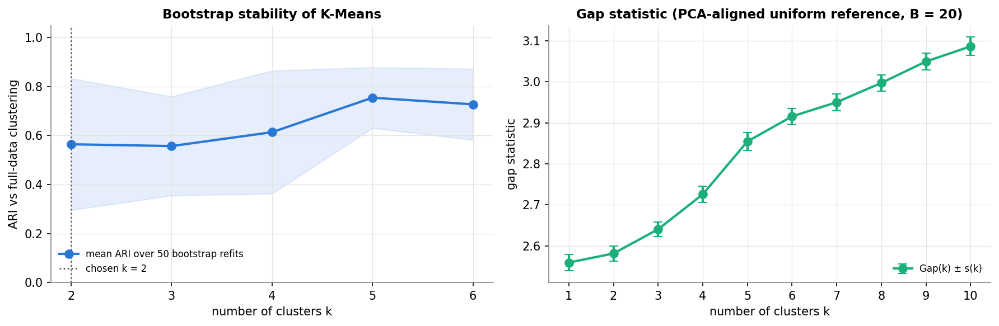{: style="width:100%"}

Figure 22 — Bootstrap stability of K-Means (left) and the gap statistic (right), standardized Wholesale data; left band = mean ARI ± 1 std over the 50 bootstrap refits, capped at 1 (figures/x4_stability_and_gap.png, tables/x4_bootstrap_stability.csv, tables/x4_gap_statistic.csv).

**Interpretation (Figure 22).** These checks are less flattering, and we report them as they are.

* **k=2 is only moderately stable** (mean ARI 0.56 between the full-data partition and 50 bootstrap refits). In 34% of refits one centroid lands on a tiny group (< 5% of customers); in the other 66% the retail-vs-rest split re-appears (ARI 0.73). The instability comes mostly from the outliers, but the main boundary also moves; with the extreme spenders capped, k=2 still finds the same split (ARI 0.80, Table 10b) and becomes the most stable k (bootstrap mean ARI 0.85 vs 0.69–0.77 for k=3–6, 70% of refits above 0.8, no tiny cluster; tables/x4_bootstrap_stability_capped.csv).
* **k=5–6 look more stable** (mean ARI 0.755 and 0.728 vs 0.564 for k=2) because their extra centroids reliably isolate the extreme spenders (a tiny cluster in every refit); k=4 also has one in every refit but scores only 0.614, so this is partly stability of the outlier clusters, not a better segmentation.
* **The gap statistic** (Tibshirani et al. 2001) **never satisfies its selection rule** (smallest k with Gap(k) ≥ Gap(k+1) − s(k+1)): the gap rises at every k. We keep it as a documented negative result.

## A.5 Robustness checks

Notebook section R repeats parts of Task 5 under changed conditions. It runs after everything else, so no number above changes; every choice is still made by 5-fold CV on the training set, and the test set only scores.

| search | model | settings | CV-chosen setting | CV acc | test acc | still on an edge |
|:---|:---|---:|:---|---:|---:|:---|
| Table 11 grid | Gradient Boosting | 8 | 300 trees, lr 0.1, depth 5 | 0.9549 | 0.9457 | all three |
| + steps past its edges | Gradient Boosting | 12 | 500 trees | 0.9579 | 0.9457 | none (lr, depth not varied) |
| Table 11 grid | XGBoost | 36 | 300 trees, lr 0.1, depth 7 | 0.9576 | 0.9468 | depth |
| + depth 9, 11 | XGBoost | 38 | depth 9 | 0.9584 | 0.9490 | none (trees, lr not varied) |
| Table 11 grid | AdaBoost | 6 | 300 stumps, lr 1.0 | 0.9424 | 0.9294 | lr |
| + lr 1.5, 2.0 | AdaBoost | 8 | lr 1.5 | 0.9429 | 0.9414 | none (trees not varied) |
| Table 11 grid + base-tree depth 2–5 | AdaBoost | 10 | depth 5 | 0.9579 | 0.9457 | depth (lr, trees not varied) |
| RF-importance selection, k ∈ &#123;40, 57&#125; | Random Forest | 4 | k = 57, no depth limit | 0.9527 | 0.9457 | none |
| PCA, n ∈ &#123;43, 48, 57&#125; | Random Forest | 6 | n = 48, no depth limit | 0.9329 | 0.9240 | none |
| no selection or PCA | XGBoost | 4 | depth 9 | 0.9584 | 0.9490 | none |
| RF-importance selection, k ∈ &#123;40, 57&#125; | XGBoost | 8 | k = 40, depth 11 | 0.9592 | 0.9457 | k, depth |
| PCA, n ∈ &#123;43, 48, 57&#125; | XGBoost | 12 | n = 57, depth 5 | 0.9427 | 0.9229 | depth |

Table 18 — Robustness checks of the Task 5 tuning: the CV-chosen setting of each search and its parameters still at the smallest or largest value tried (57 features and no depth limit cannot be exceeded and do not count); "not varied" = tried at one value only at that setting, so its edge status is unknown; the last five rows search only max_depth and k or n, with the other parameters at Table 11's values (not varied) (tables/r_grid_edges.csv, tables/r_adaboost_base_depth.csv, tables/r_fs_pca_retuned.csv).

* **Duplicate e-mails** (tables/r_duplicate_counts.csv, tables/r_test_all_vs_no_copy.csv, tables/r_mcnemar_all_vs_no_copy.csv, tables/r_grouped_cv.csv). Counted within the training set alone, 284 training e-mails repeat an earlier training e-mail, and 104 of the 921 test e-mails have a copy in the training set; separately, one feature row occurs in the training set with both labels. The tree, RF, XGBoost and GB classify all 104 copies correctly (AdaBoost 95.2%, Task 3's logistic regression 97.1%). On the 817 test e-mails without a copy every model loses 0.3–1.0 accuracy points (XGBoost 0.9468 → 0.9400, Decision Tree 0.9197 → 0.9094) and the ranking is unchanged. RF, XGBoost and GB still beat the tree after Holm (p 0.012–0.021), but XGBoost's lead over AdaBoost falls from 24 vs 8 discordant e-mails (Holm p 0.049) to 19 vs 8 (exact p 0.052, Holm p 0.37): the five copies AdaBoost misclassifies carried the significance, while a 1.3-point lead remains. In the 5-fold CV used for tuning, 372 of the 3,680 validation e-mails (10.1%) have a copy in their training folds (tables/r_cv_folds_with_train_copy.csv); keeping every copy of an e-mail in one CV fold (`StratifiedGroupKFold`) lowers XGBoost's CV accuracy from 0.9576 to 0.9557, a fifth of a fold std, so copies across folds barely inflate XGBoost's CV estimate (the other models were not re-scored this way).
* **Grid edges.** Each parameter whose Table 11 optimum sat on an edge moves past it while the others keep their Table 11 values (GB: 500 and 800 trees, depth 7, lr 0.2; XGBoost: depth 9 and 11; AdaBoost: lr 1.5 and 2.0). The new optima lie inside the wider ranges, but their other parameters were not varied. CV rises by 0.05–0.30 points, each within one fold std; the CV ranking is unchanged, and XGBoost's CV lead over GB shrinks from 0.27 to 0.05 points, as Section 8's grid-range reading predicts. AdaBoost's test accuracy rises 1.2 points while its CV rises only 0.05, so CV gives no reason to expect that gain and we do not count it.
* **AdaBoost's base trees.** At Table 11's lr 1.0 and 300 trees, CV accuracy rises with the base-tree depth (0.9424 with stumps; 0.9446, 0.9465, 0.9573 and 0.9579 at depths 2–5). The CV-best depth, 5, is the largest tried, and with it AdaBoost scores 0.9457 on the test set, like RF and GB. Its lower rank in Section 8 belongs to the stumps, not to AdaBoost.
* **Feature selection and PCA, retuned.** Table 13 kept Table 11's settings, used MI selection and stopped at k, n = 40; here max_depth is tuned together with PCA or with Task 2's RF-importance selector (in place of MI), with k ∈ {40, 57} and n ∈ {43, 48, 57} (57 = no reduction). Random Forest's CV keeps all 57 features, and PCA costs it 2.0 CV points. For XGBoost, PCA costs 1.6 CV points even at n = 57 (at depth 5, the smallest depth tried); CV prefers 40 RF-selected features by 0.08 points (about a tenth of a fold std, with k and depth on edges), and that setting scores 0.3 points lower on the test set. Section 8's conclusion holds: PCA hurts the ensembles, and the RF-importance selector gives no reliable gain either.

Two readings that Tables 12 and 15 invite do not survive these checks, and Sections 8 and A.1 already take both into account: that XGBoost's lead over AdaBoost is significant (it rests on five duplicated test e-mails) and that AdaBoost is weak as a model (the weakness belongs to its fixed stumps). The other Task 5 conclusions hold.

# References

* Breiman, L. (2001). Random forests. *Machine Learning*, 45(1), 5–32.
* Breiman, L., Friedman, J. H., Olshen, R. A., & Stone, C. J. (1984). *Classification and Regression Trees*. Wadsworth.
* Cardoso, M. (2013). Wholesale customers [Dataset]. UCI Machine Learning Repository. https://archive.ics.uci.edu/dataset/292/wholesale+customers
* Chen, T., & Guestrin, C. (2016). XGBoost: A scalable tree boosting system. *Proceedings of the 22nd ACM SIGKDD International Conference on Knowledge Discovery and Data Mining*, 785–794.
* Efron, B., & Tibshirani, R. J. (1993). *An Introduction to the Bootstrap*. Chapman & Hall.
* Friedman, J. H. (2001). Greedy function approximation: A gradient boosting machine. *Annals of Statistics*, 29(5), 1189–1232.
* Holm, S. (1979). A simple sequentially rejective multiple test procedure. *Scandinavian Journal of Statistics*, 6(2), 65–70.
* Hopkins, M., Reeber, E., Forman, G., & Suermondt, J. (1999). Spambase [Dataset]. UCI Machine Learning Repository. https://archive.ics.uci.edu/dataset/94/spambase
* Hubert, L., & Arabie, P. (1985). Comparing partitions. *Journal of Classification*, 2(1), 193–218.
* McNemar, Q. (1947). Note on the sampling error of the difference between correlated proportions or percentages. *Psychometrika*, 12(2), 153–157.
* Pedregosa, F., et al. (2011). Scikit-learn: Machine learning in Python. *Journal of Machine Learning Research*, 12, 2825–2830.
* Rousseeuw, P. J. (1987). Silhouettes: A graphical aid to the interpretation and validation of cluster analysis. *Journal of Computational and Applied Mathematics*, 20, 53–65.
* Tibshirani, R., Walther, G., & Hastie, T. (2001). Estimating the number of clusters in a data set via the gap statistic. *Journal of the Royal Statistical Society: Series B*, 63(2), 411–423.
* Zhu, J., Zou, H., Rosset, S., & Hastie, T. (2009). Multi-class AdaBoost. *Statistics and Its Interface*, 2(3), 349–360.
